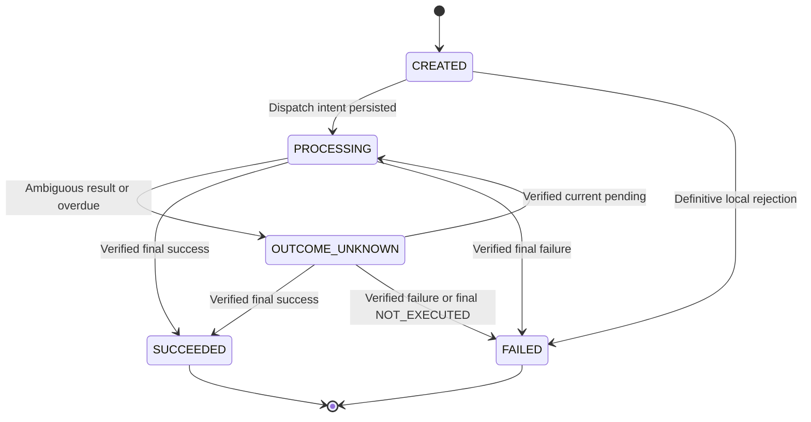
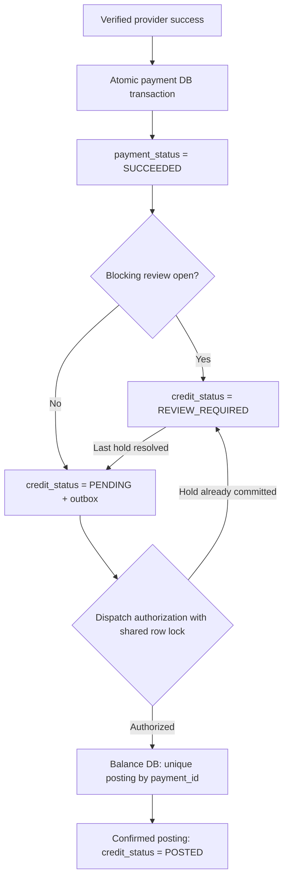
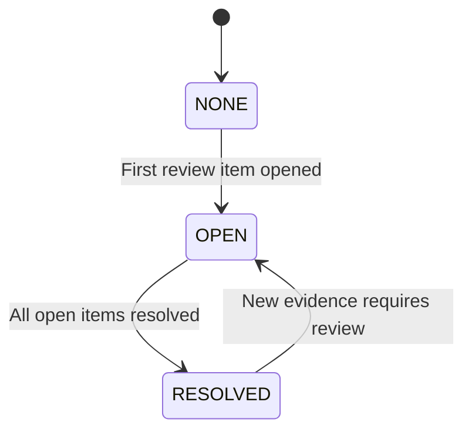
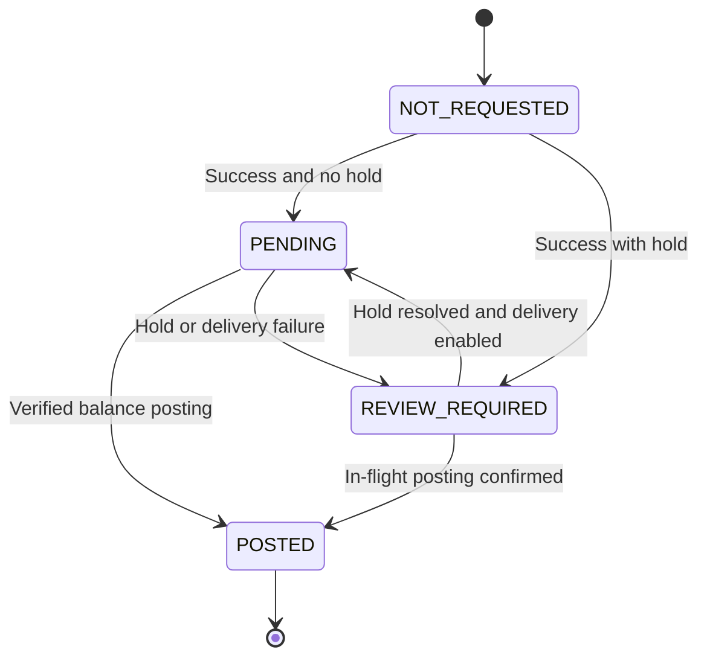

# Payment Timeout: States, Idempotency, and Recovery

Series: Inside the Spec  
Subtitle: Real Scenarios. Working Artifacts. Decisions That Matter.  
Case: 01  
Author: Yulia Melekhova  
Version: 0.3  
Language: en  
Status: Draft

## Purpose

This specification defines balance top-up behavior when the outcome of a request to a payment provider is unknown. Use the models, rules, and acceptance scenarios together: the state diagram alone does not define the complete contract.

## Scenario and Boundaries

A user tops up a balance by €50: `amount_minor=5000`, `currency=EUR`. The create request times out; the provider may have accepted the payment. The user retries, and confirmation may arrive later through a webhook or status lookup.

This is an illustrative case with the assumptions below. It does not describe a particular provider's contract, a personal production incident, or an integration ready for deployment. All intervals and limits are design choices for this case, with no claimed measurements.

Scope includes one provider, final payment outcomes, unknown outcomes, repeated requests, status lookup, manual review, delivery of balance-credit instructions, and a possible-duplicate check for a new client key.

### Provider Assumptions

| ID | Assumption |
|---|---|
| PA-01 | One provider key with the same parameters identifies one operation. The provider guarantees this for concurrent requests within the window as well |
| PA-02 | The idempotency window lasts 24 hours from the first accepted create request; a network retry does not extend it |
| PA-03 | Lookup is available by a stable `merchant_reference`; `NOT_FOUND` may be temporary and does not prove that no payment exists |
| PA-04 | `SUCCEEDED` and `FAILED` are final for this operation; refunds and reversals are separate operations |
| PA-05 | HTTP responses, webhooks, and lookup results allow verification of operation identity and parameters |
| PA-06 | A webhook has a stable `event_id` and event body; each redelivery has a new timestamp and signature |
| PA-07 | A provider state version, if supplied, is comparable across channels. Without a version, a delayed `PENDING` cannot be treated as current solely because it arrived later |
| PA-08 | Automated negative closure requires final NOT_EXECUTED evidence and a future-execution fence for the reference; see Appendix F |

Verify every assumption against the selected provider's contract before a real implementation.

## Artifact 1. Payment State Machine

| Field | Values | Meaning |
|---|---|---|
| `payment_status` | `CREATED`, `PROCESSING`, `OUTCOME_UNKNOWN`, `SUCCEEDED`, `FAILED` | Payment outcome known to our service |
| `review_status` | `NONE`, `OPEN`, `RESOLVED` | Aggregate state of review items |
| `credit_status` | `NOT_REQUESTED`, `PENDING`, `POSTED`, `REVIEW_REQUIRED` | Balance-credit state |



`PROCESSING` means dispatch may have started or the provider has confirmed ongoing processing. It does not prove a charge. Dispatch intent is saved before the network call; a crash between those actions leaves an ambiguous attempt.

`OUTCOME_UNKNOWN` does not become `FAILED` because a timer expires, lookup returns `NOT_FOUND`, attempts are exhausted, or the idempotency window closes. Retrying create alone does not move an operation out of `OUTCOME_UNKNOWN`.

Final states do not change automatically. A contradictory final result opens a review. An old `PENDING` or a delayed timeout cannot downgrade a final state.

### Coupling Payment, Review, and Credit



The main view links payment success to review evaluation and credit initiation. Its outbox is local to the payment DB; the balance DB is a separate transaction. CR-01/CR-02 define atomicity and the dispatch boundary.

## Artifact 2. State Transition Table

Each handler checks outcome evidence, the current state, and the operation version. Applying incoming evidence, updating the operation, and creating an outbox record are atomic; evidence may first be durably saved to an inbox for later processing.

| ID | From | Condition | To | Action |
|---|---|---|---|---|
| ST-01 | No operation | Valid new key; duplicate guard permits creation | `CREATED` | Atomically bind key, fingerprint, and operation |
| ST-02 | `CREATED` | Dispatch owner saves intent | `PROCESSING` | Save reference, provider key, and attempt before the call |
| ST-03 | `CREATED` | Definitive local rejection before dispatch intent | `FAILED` | Save reason; no external call |
| ST-04 | `PROCESSING` | Timeout, ambiguous response, undocumented 5xx | `OUTCOME_UNKNOWN` | Save classification; schedule lookup |
| ST-05 | `PROCESSING` | An unfinished create attempt is found after a crash | `OUTCOME_UNKNOWN` | Recover using the same reference and key |
| ST-06 | `PROCESSING` / `OUTCOME_UNKNOWN` | Verified final success | `SUCCEEDED` | Save evidence; apply credit gate CR-01 |
| ST-07 | `PROCESSING` / `OUTCOME_UNKNOWN` | Verified final failure | `FAILED` | Save evidence; no balance credit |
| ST-08 | `OUTCOME_UNKNOWN` | Verified current `PENDING` | `PROCESSING` | Continue observation; do not create a new payment |
| ST-09 | `PROCESSING` | No final outcome by the next check deadline | `OUTCOME_UNKNOWN` | Run lookup; open review at one hour |
| ST-10 | Nonfinal | Lookup returns `NOT_FOUND`, timeout, or error | Unchanged | A lookup error does not establish the create outcome |
| ST-11 | Any | Same client key and fingerprint | Unchanged | Return API-01 PaymentStatus; POST 202 nonfinal / 200 final |
| ST-12 | Final | Same final result again | Unchanged | Deduplicate; do not repeat business effects |
| ST-13 | Final | Old `PENDING` or timeout | Unchanged | Save observation |
| ST-14 | Final | Contradictory final result | Unchanged | Open `CONFLICTING_FINAL_RESULTS`; hold credit dispatch that has not started |
| ST-15 | Nonfinal | No result after one hour, or safe recovery is blocked | Unchanged | Open `RESULT_OVERDUE` or `RECOVERY_BLOCKED`; exhausting the create budget alone does not stop lookup |
| ST-16 | Any | Untrusted message or parameter mismatch | Unchanged | Reject application; record anomaly |
| ST-17 | Any | Version conflict during concurrent processing | Reevaluate | Reload operation; reevaluate the original evidence |
| ST-18 | Nonfinal | Verified final NOT_EXECUTED under PA-08 | `FAILED` | Save proof, close supported overdue/reconciliation case, and release guard atomically; no credit |

A comparable provider version or a documented lookup guarantee of current state establishes whether `PENDING` is current. Without either guarantee, save the observation without ST-08. A final result still follows PA-04 and ST-14.

## Artifact 3. Idempotency Contract

### Operation Identity

| Field | Contract |
|---|---|
| `client_idempotency_key` | One key per top-up intent; the client retains it across reloads and network failures |
| Key scope | `user_id + operation_type + client_idempotency_key` |
| `payment_id` | One internal operation identifier |
| `request_fingerprint` | Canonical `amount_minor`, `currency`, `payment_instrument_id`; user and operation type are defined by key scope |
| `provider_idempotency_key` | Persisted before the first call; unchanged for initial and repeated create |
| `merchant_reference` | Stable operation reference for lookup and reconciliation |
| `attempt_id` | Separate identifier for each outgoing CREATE or LOOKUP |

The amount is an integer in minor units; currency is normalized to the agreed uppercase code. The instrument is an opaque internal identifier. Compute the fingerprint from an unambiguous serialization of fixed fields, rather than arbitrary source JSON. Changes to canonicalization require fingerprint versioning.

| ID | Rule |
|---|---|
| IC-01 | A storage constraint enforces client-key uniqueness |
| IC-02 | Key, fingerprint, and operation are committed atomically |
| IC-03 | The same key with a different fingerprint returns `409 IDEMPOTENCY_KEY_REUSED` |
| IC-04 | Same key and fingerprint return PaymentStatus: POST 202 for every nonfinal state, POST 200 for a final state; see API-01 |
| IC-05 | A client retry does not trigger an additional provider create |
| IC-06 | One operation owner controls recovery; automatic HTTP-client, proxy, and SDK retries are disabled for create |
| IC-07 | For an unknown outcome, run lookup before an eligible retry |
| IC-08 | Reuse the same provider key and parameters; at most two create calls in total, including the initial call |
| IC-09 | Automatic create is prohibited after the local cutoff, regardless of lookup results |
| IC-10 | Do not call the provider without a durable operation record and an attempt reservation |
| IC-11 | The balance service atomically enforces at most one credit posting per `payment_id` |
| IC-12 | A separate duplicate guard checks a new client key; a key alone does not prevent every semantic duplicate |
| IC-13 | Before a retry, atomically reserve the remaining create budget and check state, ownership, holds, and cutoff |

### Recovery Parameters

| Parameter | Value in this case |
|---|---|
| CREATE / LOOKUP timeout | 10 seconds per call |
| `recovery_started_at` | Time of the first unknown outcome or the first need to defer create after confirmed nonacceptance |
| Lookup schedule | 15 seconds, 1 minute, 5 minutes, 15 minutes, and 1 hour after `recovery_started_at` |
| Missed deadlines | After restart, perform one current check; do not send a burst of missed calls |
| Create budget | Initial call plus at most one automatic retry; `429` consumes the same budget |
| Retry after unknown | Only after lookup returns `NOT_FOUND`, with an open window and no holds |
| Retry after proven nonacceptance | Lookup is optional only if all preceding attempts are proven not to have created an operation |
| Time limit | Schedule retry before `RESULT_OVERDUE` review at one hour; opening that review stops automatic create |
| Cutoff | Strictly before `first_dispatch_at + 23 hours`; an additional safety boundary |
| Late events | Continue receiving and verifying them after operator handoff |
| Manual lookup / reconciliation | Operator lookup after one hour; daily registry reconciliation under Appendix F |
| Client-key retention | At least 30 days and until all related uncertainty, credit delivery, and reviews are resolved, if longer |

The 23-hour cutoff leaves a margin against PA-02. It is safe only when window semantics are verified and retry delivery delay is bounded by that margin. If that bound cannot be ensured, disable create retries; retain lookup and review.

For proven nonacceptance with `429`, honor a valid `Retry-After`. Without it, delay the single retry by 2–4 seconds with jitter. For an unknown `429` outcome, Retry-After is a lower bound on retry timing, but lookup is still required. Cancel the retry if eligibility begins after one hour or the cutoff.

Attempt reservation consumes the budget conservatively: a crash before the network call does not automatically restore the slot. Reduced availability is preferable to an unaccounted extra create.

### Our API Responses

| Situation | HTTP | Result |
|---|---|---|
| New or repeated nonfinal operation | `202` | Existing `payment_id`, three statuses, and a status URL |
| Repeated final operation | `200` | Same `payment_id`; payment success does not promise `credit_status=POSTED` |
| Existing key with different parameters | `409` | `IDEMPOTENCY_KEY_REUSED` |
| New key rejected by duplicate guard | `409` | `POSSIBLE_DUPLICATE_PAYMENT`, with the original operation ID accessible to this user |
| Operation cannot be reliably saved | `503` | No external call; client retains the same key |

If `503` follows a lost commit response, the operation may already have been saved. A retry with the same key finds it; no provider call is permitted without confirmed durable storage. Authentication and basic validation errors are handled before this business logic.

### API-01. Response DTO and Client Behavior

For POST create or a same-key replay, `CREATED`, `PROCESSING`, and `OUTCOME_UNKNOWN` always return `202 Accepted` with the same `PaymentStatus` DTO. A final payment returns `200 OK` with that DTO. A successful `GET /payments/{payment_id}` returns `200 OK` for every payment state; clients inspect the body. These rules apply to the response snapshot, not a promise that state cannot change immediately afterward.

An illustrative nonfinal response:

```json
{
  "payment_id": "pay-001",
  "payment_status": "PROCESSING",
  "credit_status": "NOT_REQUESTED",
  "review_status": "NONE",
  "status_url": "/payments/pay-001",
  "next_action": "WAIT",
  "poll_after_seconds": 5,
  "retry_post": false
}
```

All fields are required. Status fields use the enums in Artifact 1. `status_url` is an authenticated relative URL accessible only to the operation's owner. `next_action` is `CONTACT_SUPPORT` when a review is open; otherwise `WAIT` while the payment is nonfinal or credit is pending; otherwise `NONE`. `poll_after_seconds` is 5 for `WAIT` and null otherwise. `retry_post` is always false in a status response: use GET, not another create. These UI instructions do not replace authorization or concurrency checks.

The client stops create retries on any valid 202 or 200 status response. Foreground GET polling runs no more often than every 5 seconds, for at most 60 seconds; then it stops and leaves the operation visible for later refresh. Polling stops early for `CONTACT_SUPPORT` or `NONE`. A GET 200 is not itself proof of payment success. Network errors or 503 before an operation ID is known permit at most one automatic POST replay with the original key, then a visible recovery action; they never permit a new key. A known ID is recovered by GET. This client budget is separate from the provider CREATE budget.

`409 POSSIBLE_DUPLICATE_PAYMENT` returns this envelope:

```json
{
  "error": "POSSIBLE_DUPLICATE_PAYMENT",
  "next_action": "SHOW_EXISTING_PAYMENT",
  "retry_post": false,
  "existing_operation": {
    "payment_id": "pay-001",
    "payment_status": "OUTCOME_UNKNOWN",
    "credit_status": "NOT_REQUESTED",
    "review_status": "OPEN",
    "status_url": "/payments/pay-001",
    "next_action": "CONTACT_SUPPORT",
    "poll_after_seconds": null,
    "retry_post": false
  }
}
```

`existing_operation` is the full `PaymentStatus` snapshot, not just an ID. The interface opens that operation and follows its next action; it does not generate another key or show the second request as accepted. A concurrent final result may make the snapshot stale; GET refreshes it. Each response includes `Cache-Control: no-store`; POST 202 also includes `Location` matching `status_url`. The request key and credentials are not echoed.

The choice of 202 with a current status and monitor follows [RFC 9110, Section 15.3.3](https://www.rfc-editor.org/rfc/rfc9110.html#section-15.3.3). Polling limits and DTO fields are design choices of this case, not requirements imposed by the RFC.

### Duplicate Guard

Check authentication and validation first, then the existing client key. Apply the guard only to a new key. A replay of an accepted key returns its own operation under API-01.

Block a new key whenever the same user has a payment with the same instrument, amount, and currency in `CREATED`, `PROCESSING`, or `OUTCOME_UNKNOWN`, regardless of age. Return `409 POSSIBLE_DUPLICATE_PAYMENT` with API-01's existing-operation snapshot and `SHOW_EXISTING_PAYMENT`. Do not create a new operation or bind the rejected key. No five-minute expiry or user override exists in this version.

Serialize the check and creation with a durable lock by user, operation type, instrument, normalized amount, and currency. The lock must exist even when no payment row matches. Both creation and resolution acquire the same lock, so two new keys cannot pass together and resolution cannot release protection before its commit. Releasing a lock never deletes the unresolved-payment predicate.

Release the guard only when the original payment is definitively `SUCCEEDED` or `FAILED`, including authoritative `NOT_EXECUTED` closure under Appendix F. Review age, manual handoff, and window expiry never release it. This availability trade-off is intentional: another identical top-up must wait for evidence. A separate policy would be needed to allow an intentional second identical payment while the first is unresolved.

Different instruments, different amounts, and new top-ups after final success remain outside this guard. A new key after final success can still be a semantic duplicate; the interface shows the completed operation before presenting a new top-up action. This guard is not a complete fraud or duplicate-charge prevention system.

## Artifact 4. Idempotency Matrix

| ID | Situation | Expected behavior | Additional CREATE |
|---|---|---|---|
| IM-01 | New key, valid data | One operation | Initial call |
| IM-02 | Retry in `CREATED` | Same ID; dispatch owner picks up initial send | Only the initial call not yet performed |
| IM-03 | Retry in `PROCESSING` | `202`, API-01 PaymentStatus; client uses GET | None due to client retry |
| IM-04 | Retry in `OUTCOME_UNKNOWN` | `202`; continue recovery | Only under IC-07–IC-09 |
| IM-05 | Same key, different parameters | `409 IDEMPOTENCY_KEY_REUSED` | None |
| IM-06 | Concurrent identical requests | One ID | One initial call |
| IM-07 | Concurrent different payloads with one key | Accept one; return `409` for the other | For the accepted operation |
| IM-08 | Retry after success | Same success and credit state | None |
| IM-09 | Retry after failure | Same failure | None |
| IM-10 | Unknown; lookup `NOT_FOUND`; open window | Stay unknown until evidence arrives | One, if budget remains |
| IM-11 | Retried create is ambiguous again | Lookup and incoming confirmations only | None |
| IM-12 | Lookup `NOT_FOUND` after cutoff | Unknown and review | None |
| IM-13 | New key matches unresolved payment, regardless of age | `409` with existing PaymentStatus and SHOW_EXISTING_PAYMENT | None |
| IM-14 | Crash after dispatch, before response | Find attempt; start recovery | Within the shared budget |
| IM-15 | Two recovery workers | One reserved attempt | Within the shared budget |
| IM-16 | Success while preparing retry | Cancel an unstarted send if success is already visible; process result | An already dispatched retry is safe only under PA-01 |
| IM-17 | Repeated success webhook | One application, one logical task | None |
| IM-18 | Successful payment; credit incomplete | Recover credit by `payment_id` | None |
| IM-19 | Storage unavailable before save | `503`; no call | None |
| IM-20 | Old client-key binding legitimately deleted | Request may be new; recheck guard | Initial call possible |
| IM-21 | Proven nonacceptance with `429` | Defer using Retry-After; honor remaining budget | At most one retry |
| IM-22 | Webhook and lookup report the same success | One transition and one logical task | None |
| IM-23 | Webhook and lookup report different final outcomes | Retain first accepted final state; open conflict | None |
| IM-24 | Late success during `RESULT_OVERDUE` | Success; close only overdue item; assess other reasons | None |
| IM-25 | New key after 6 minutes or 24 hours; previous payment unknown | Guard still blocks; return existing operation | None |

## Appendix A. Review Lifecycle



`review_status` aggregates a set of `review_items`. Each item has `review_id`, `payment_id`, `reason`, `status`, `owner`, `opened_at`, `next_action_at`, `resolved_at`, `resolution_code`, evidence references, and an action log. The aggregate is `OPEN` while any reason is open; `NONE` if there is no review history; and `RESOLVED` once all reasons are closed.

| Reason | Owner | Blocks credit | Resolution |
|---|---|---|---|
| `RESULT_OVERDUE` | Payment Operations | Not by itself | Automatically on a verified final result |
| `RECOVERY_BLOCKED` | Payment Operations | Not by itself | Operator removes obstacle; final confirmation resolves only the unknown-outcome reason, not a configuration defect |
| `CONFLICTING_FINAL_RESULTS` | Payment Operations | Yes, if credit dispatch has not started | Investigate evidence; ordinary handlers do not correct a final state |
| `PARAMETER_MISMATCH` | Payment Operations | Yes | Verify ownership, amount, and currency |
| `SECURITY_HOLD` | Security Operations | Yes | Authorized staff remove hold with a recorded justification |
| `CREDIT_DELIVERY_FAILED` | Balance Operations | Until cause is resolved | Recover task and confirm posting |

Schedule the owner's first action within 30 minutes of opening. A missed deadline raises an operational alert. This is a target for the case, not a promise of actual resolution time.

A late verified final result may update a nonfinal `payment_status` even during review. It automatically closes only `RESULT_OVERDUE`, with `AUTO_PROVIDER_CONFIRMATION`. Other reasons remain open. An invalid webhook alone does not create a blocking review for an arbitrarily supplied payment ID: that would let an attacker block credit. A hold requires a trusted link to the operation and a separate basis.

An operator cannot assign success without provider evidence. Correcting an already final outcome requires a separate procedure with authorization and audit; that procedure is outside this model.

## Appendix B. Provider Error Classification

| CREATE response | Known fact | Decision |
|---|---|---|
| `429` with a contractual nonacceptance guarantee | This attempt did not create an operation | One deferred retry, provided earlier attempts did not leave an unknown outcome |
| `429` without that guarantee | Outcome unknown | ST-04; lookup before an eligible retry |
| `502`, `503`, `504`, disconnect, timeout, malformed response | Unknown without a separate guarantee | ST-04; lookup and the shared create budget |
| Documented final rejection guaranteeing no operation | Proven business failure | `FAILED` |
| Provider-key conflict | Existing operation or parameter mismatch possible | Lookup; review mismatches, without a new key |
| Authorization/configuration error | Call requires operational intervention | Stop create retries; verify semantics. Unknown if nonacceptance is not proven |

An HTTP code alone does not prove the payment outcome. Proven nonacceptance of the second attempt does not resolve uncertainty about the first. A LOOKUP error describes the status check and does not move the payment to `FAILED`.

## Appendix C. Webhook Contract

This is the chosen contract of an illustrative provider, without a claim that real payment APIs support these headers.

| Element | Requirement |
|---|---|
| Channel | HTTPS; limit body to 64 KiB before business parsing |
| Headers | `X-Webhook-Key-Id`, `X-Webhook-Timestamp`, `X-Webhook-Signature` |
| Timestamp | Integer Unix delivery time in seconds; accept an offset of at most 300 seconds |
| Signed bytes | ASCII(timestamp), one dot byte `0x2E`, then the original HTTP-body bytes |
| Signature | HMAC-SHA256; 64 hex characters; compare decoded bytes in constant time |
| Payload | Mandatory nonempty `event_id` in the signed body, merchant account, payment ID, reference, amount, currency, status; event version if available |
| Secret | Secret manager; separate values per environment and endpoint; never logged |
| Rotation | Key ID selects the active or previous key; accept the previous key for at most 24 hours after activating the new one |
| Deduplication | Unique `provider + event_id`; fingerprint original body |
| Retention | Inbox and dedup markers for at least 30 days and until associated operations/reviews close, if longer |

Order: limit size, validate headers and timestamp, verify signature over original bytes, parse payload, match merchant and operation, and durably save inbox. Return `2xx` after durable save, not after balance credit. Return `503` if inbox storage is unavailable; `401` for invalid signature or timestamp; `400` for malformed payload; and `413` for excess size.

An absent, empty, or invalid `event_id` is a schema error: return `400`, do not apply the event, and use trusted lookup for recovery. This case does not support providers without stable signed event identity. Replaying the same valid delivery within 300 seconds hits the unique inbox constraint and cannot repeat business effects. Hashing body plus delivery timestamp is not a substitute: the timestamp changes on legitimate redelivery. Body hash is used to detect conflicting payloads, not to invent business-event identity.

An exact duplicate of a saved event receives `2xx`. If the same event ID has a different body with a valid signature, preserve both pieces of evidence, do not automatically apply the second, and record an anomaly. Return `2xx` after durable quarantine to avoid endless redelivery.

A fresh signature does not make an event current in business terms. An old event with a fresh delivery is acceptable; assess its transition under ST-08 and ST-12–ST-14. After dedup retention expires, state rules and posting uniqueness still constrain repeats, but the previous event-ID recognition guarantee ends.

## Appendix D. Balance Credit and Outbox

### CR-01. Credit Gate

On verified success:

1. Set `payment_status=SUCCEEDED` and save evidence.
2. If a blocking reason is open, set `credit_status=REVIEW_REQUIRED`; automatic credit is not authorized.
3. If no hold exists, set `credit_status=PENDING` and create one logical `CreditRequested(payment_id)` task in the same transaction.

Removing the last blocking reason for a successful payment atomically moves `REVIEW_REQUIRED` to `PENDING` and ensures one logical task exists. Reopening a hold prevents dispatch of an unstarted task; checking only at outbox creation is insufficient.



The worker atomically reserves dispatch while rechecking blocking reasons. That transaction is the boundary after which the call counts as started. If review opens later, an external call already in progress may create a posting. `POSTED` records a verified fact and does not roll back when review opens. Strict blocking through the posting commit requires a separate authorization protocol involving the balance service; it is outside scope.

| Event | Behavior |
|---|---|
| Balance-service timeout or 5xx | Retry with the same `payment_id` |
| Posting created, response lost | Retry returns existing posting; state becomes `POSTED` |
| Worker crashes after processing | Lease expires; another worker safely redelivers |
| Permanent data error | `REVIEW_REQUIRED`; stop delivery; open `CREDIT_DELIVERY_FAILED` |
| Unavailable for 24 hours | Retain task in manual recovery queue; do not delete |
| Same posting ID, different amount | Integrity error and manual review; do not alter existing posting |

The balance service atomically creates the posting and enforces `payment_id` uniqueness; repeats also check amount, currency, and beneficiary. The outbox enables redelivery; it does not ensure a unique financial effect by itself.

### CR-02. Local Atomicity and the Dispatch Boundary

Only the payment update and outbox insert share one local payment-database transaction. The balance posting is a later transaction in the balance database; no cross-database atomic commit, distributed transaction, or Saga is claimed here. The financial effect relies on durable redelivery and atomic balance-side deduplication by `payment_id`.

Reading or claiming an outbox row is not authorization to call the balance service. Before sending, the worker starts a local transaction, locks the payment row, rereads all blocking reasons, and atomically records a delivery attempt as `DISPATCH_AUTHORIZED`. Every operation that opens/closes a credit hold must lock that same payment row. Thus the two commits have a defined order:

| Order of commits | Required behavior |
|---|---|
| Hold commits before dispatch authorization | No balance call; keep credit on review, even if the worker previously read the task |
| Dispatch authorization commits before hold | This attempt may execute; hold prevents later attempts but cannot revoke that authorization |

The authorization commit, not an ordinary queue read or physical network send, is the logical start boundary in this case. If the worker crashes after authorization with no known result, preserve the ambiguous delivery attempt. A later confirmed posting is recorded even during a hold; retrying dispatch while a hold exists is prohibited. A balance-side status lookup may establish whether the posting exists; without that capability, manual resolution is required while held.

A disconnect before a first credit response cannot prove whether a posting committed. Without a hold, redeliver the exact same task and `payment_id`: if a posting exists, the balance service returns it; otherwise it creates it once. Do not mark the payment failed or the task delivered on a timeout.

This contract does not promise that a hold committed after authorization prevents the physical call or financial commit. Strict revocation would require an authorization/fencing protocol owned by the balance service. That stronger guarantee remains outside scope and cannot be achieved by adding one more local read.

Backoff: first delay 2 seconds; then `min(300, 2 * 2^(n-1))` seconds for retry n. Jitter chooses 50–100% of the calculated delay. The case-wide limit for outgoing balance calls is 10 per second and at most 10 concurrent; workers share these limits rather than multiplying them.

The circuit breaker opens after five consecutive timeout/5xx responses, stops calls for 30 seconds, then allows one probe. Success closes it; another timeout/5xx reopens it. Breaker pauses and restarts do not reset task age. A shared outage creates one operational incident with an updated count of affected operations.

Target SLO: 99.9% of successful payments without blocking reviews when success is committed receive a posting within 60 seconds, measured per calendar month. The denominator includes those payments regardless of worker or balance-service failures. Later holds do not retrospectively remove them. Report counts and age separately for excluded payments, without hiding delays.

This is a chosen case target, not yet supported by load or operational data. No customer SLA is stated. Raise a warning 2 minutes after success without a posting. The interface distinguishes “Payment confirmed. Balance credit is processing” from “Payment confirmed. Balance credit is under review.” Credit failure does not move the payment to `FAILED`.

## Appendix E. Attempts, Inbox, and Concurrency

### Attempt Model

| Group | Fields |
|---|---|
| Identity | `attempt_id`, `payment_id`, `operation_type=CREATE/LOOKUP`, `attempt_number` |
| Trigger | `trigger`, `owner_token`, `next_retry_at` |
| Tracing | `trace_id`, `correlation_id`, `provider_request_id` if available |
| Time | `started_at`, `finished_at`, `duration_ms` |
| Result | `http_status`, `provider_error_code`, `transport_outcome`, `result_classification` |
| Lifecycle | `STARTED`, `COMPLETED`, `UNRESOLVED` |

Save `STARTED` before the call. A response moves the attempt to `COMPLETED`, even when its classification is `AMBIGUOUS`: a completed network attempt does not imply a known payment outcome. If a worker is lost, its unfinished record becomes `UNRESOLVED`. A late response updates the same record and follows common result validation.

Credit sends have a separate delivery history with `outbox_id`, `delivery_attempt_id`, and `payment_id`. Incoming webhooks belong in the inbox, not `payment_attempts`. Logs must not contain secrets, payment credentials, or complete sensitive payloads.

### Concurrent Processing Order

1. Durably save evidence with a source identifier. Use `provider + event_id` for webhooks and an `attempt_id` association for CREATE/LOOKUP responses.
2. In a transaction, read the operation and active review items; verify ownership and transition eligibility.
3. Atomically apply a version-checked change, ensure the outbox record if required, and mark evidence processed.
4. On a version conflict, roll back, reread, and reevaluate the same evidence. One failed compare-and-set must not lose it.

| Race | Outcome |
|---|---|
| Lookup `PENDING` and success webhook | Final result `SUCCEEDED`; `PENDING` cannot downgrade it |
| Success from two channels | One transition, one logical task, one posting |
| Failure and success | Retain the first eligible final result; the second opens conflict. Already posted money is not automatically reversed |
| Timeout and success | Retain success regardless of commit order |
| Operator closes overdue while webhook arrives | Version check and reevaluation; close only the eligible reason |
| Recovery lease expires during a request | A new owner does not start a concurrent CREATE solely because a lease expired; an ambiguous attempt requires lookup and recovery rules |

Local leases and versions cannot revoke a network call that has started. Possible overlap of an old call and an authorized retry is protected by PA-01, the same provider key, and the shared number of reserved attempts. Without provider-side concurrent idempotency, disable automatic create retries after unknown outcomes.

## Appendix F. Reconciliation Registry and Unknown-Outcome Closure

Reconciliation compares unresolved local operations with trusted provider evidence. Its registry is separate from `payment_status`: an administrative queue state must not fabricate a financial result.

PA-08 is an additional capability required for automated negative closure in this case: the provider can issue an authoritative final disposition `NOT_EXECUTED` for the merchant account and reference, covering every create attempt and provider key. It certifies both no execution and no future execution for that reference, including delayed requests. The provider rejects future create requests for the sealed reference even after its idempotency window ends. This is an explicit illustrative requirement, not an assumed feature of real providers. Without it or equivalent verified final evidence, negative closure is unavailable.

| ID | Rule |
|---|---|
| RC-01 | At one hour unresolved, create or upsert one reconciliation case per `payment_id`; Payment Operations owns it. Stop automatic create; retain the guard |
| RC-02 | Run a daily batch at 02:00 UTC (09:00 Bangkok). Select every unresolved case, including older cases; immediately ingest independently received final evidence |
| RC-03 | Save run ID, source/report ID and version, merchant, covered interval/watermark, completeness checks, source evidence reference, and ingestion timestamp. Reruns are idempotent by source/evidence identity |
| RC-04 | Verified SUCCESS/FAILURE applies ST-06/ST-07. A success uses the same review and credit gate; a contradiction with an existing final state uses ST-14 |
| RC-05 | Missing report row, NOT_FOUND, incomplete report, or expired window never means FAILED. Retain unknown, owner, and a next action |
| RC-06 | Verified PA-08 NOT_EXECUTED moves a nonfinal payment to FAILED with `failure_reason=PROVIDER_CONFIRMED_NOT_EXECUTED`; save evidence and atomically release the duplicate guard |
| RC-07 | At 24 hours after recovery starts, escalate unresolved cases to the Payment Operations lead and request provider investigation; next operator action within 4 hours. Keep daily reconciliation |
| RC-08 | Age of 7 days triggers an incident with the payment owner and provider escalation. It does not rewrite financial state or release the guard |

Registry fields: `reconciliation_case_id`, `payment_id`, `owner`, `case_status=OPEN/ESCALATED/RESOLVED`, `opened_at`, `next_action_at`, `last_checked_at`, `evidence_refs`, and `resolution_code`. An unresolved case never becomes RESOLVED merely because a ticket is archived. Resolution and the supported payment transition commit atomically; unrelated security or configuration reviews stay open.

For NOT_EXECUTED, verify merchant, reference, all recorded attempts, authenticity, completeness/finality of the disposition, and its future-execution fence. A settlement file listing only settled transactions is insufficient: it may omit pending or delayed operations. Quarantine invalid or contradictory evidence instead of guessing. A late success after certified negative closure is a contract breach handled as ST-14; it does not silently rewrite FAILED.

Thus an unknown operation has a route to final success, final failure, or certified nonexecution, with owned escalation if evidence is unavailable. An unconditional time-to-FAILED cannot be promised. Chargeback is a separate dispute process, not a way to infer or close an unknown create outcome.

## Acceptance Scenarios and Traceability

These are expected behaviors, not a report of executed implementation tests.

| ID | Given / When | Then | References |
|---|---|---|---|
| AC-01 | Two concurrent requests with one key and data | One `payment_id`, one initial CREATE | IC-01–IC-06, IM-06 |
| AC-02 | Same key; amount changes from 5000 to 6000 | `409`; original operation unchanged | IC-03, IM-05 |
| AC-03 | CREATE timeout, lookup `NOT_FOUND`, single retry also times out | Unknown; exactly two reserved CREATE attempts; no more CREATE | ST-04, IC-08, IM-11 |
| AC-04 | First CREATE unknown; retry receives proven nonacceptance with `429` | Remain unknown; no third CREATE | Appendix B, IC-08 |
| AC-05 | First CREATE proven not accepted with `429`; Retry-After=30 seconds | No retry before 30 seconds; same provider key | IC-08, IM-21 |
| AC-06 | Retry-After delays eligibility past one hour or cutoff | No CREATE; retain review and observation | IC-09, ST-15 |
| AC-07 | Lookup `NOT_FOUND` after 24 hours | Unknown; no new provider key or CREATE | ST-10, IM-12 |
| AC-08 | Only overdue review is open; verified success arrives | `SUCCEEDED`; overdue closed; one credit task | ST-06, IM-24, CR-01 |
| AC-09 | Overdue and security hold open; success arrives | `SUCCEEDED`; overdue closed, security hold open; credit review | Appendix A, CR-01 |
| AC-10 | Last hold removed from a successful payment | `PENDING`; one logical task, even on repeated command processing | CR-01 |
| AC-11 | Invalid webhook signature with a known payment ID | Payment and holds unchanged; `401` and security event | ST-16, Appendix C |
| AC-12 | Event over a day old, delivered with fresh valid signature | Business-event age alone is not a rejection reason | Appendix C |
| AC-13 | Valid webhook repeated with new timestamp, same ID and body | `2xx`; no repeated business effect | ST-12, IM-17 |
| AC-14 | Two different signed payloads with one event ID | Preserve conflict; do not automatically apply second payload | Appendix C |
| AC-15 | Inbox unavailable | `503`; notification is not acknowledged as accepted | Appendix C |
| AC-16 | Concurrent success and `PENDING` | Final success, one posting | ST-13, ST-17, IM-22 |
| AC-17 | Concurrent verified success and failure | One final state; conflict open; no automatic posting reversal | ST-14, IM-23 |
| AC-18 | Balance posting created; response lost; delivery repeats | One posting, then `POSTED` | IC-11, Appendix D |
| AC-19 | Worker crashes after success commit, before dispatch | Task retained; restart resumes delivery | ST-06, CR-01 |
| AC-20 | Outbox exists; hold opens before dispatch reservation | No balance call; `REVIEW_REQUIRED` | CR-01 |
| AC-21 | Hold opens after balance call starts; posting is confirmed | `POSTED`; review remains; no promise to revoke the call | Appendix D |
| AC-22 | Two new keys with matching attributes arrive together while the original is unresolved | One operation; second request gets `409 POSSIBLE_DUPLICATE_PAYMENT` | Duplicate guard, IM-13 |
| AC-23 | New key after 6 minutes; first payment unknown | Still 409; return existing PaymentStatus, no second payment | IM-25, API-01 |
| AC-24 | Storage unavailable before attempt reservation | No provider call | IC-10 |
| AC-25 | Worker lost after saving attempt, before network call | Budget slot not automatically restored; unresolved attempt | IC-13, Appendix E |
| AC-26 | 30 days elapsed, but review open or posting unconfirmed | Do not delete client-key binding | Retention |
| AC-27 | Five consecutive balance-service 5xx responses | Breaker open; tasks retained; probe after 30 seconds | Appendix D |
| AC-28 | Workers unavailable for 10 minutes after success | Payment retained; overdue credit counts as an SLO miss if in denominator | Appendix D |
| AC-29 | Each nonfinal state is returned by POST replay | 202 and the complete API-01 DTO; client stops POST and uses bounded GET | API-01, IC-04, ST-11 |
| AC-30 | GET returns a known nonfinal payment | 200 with the same DTO; HTTP 200 is not financial success | API-01 |
| AC-31 | Duplicate guard rejects a new key | 409 with existing_operation and SHOW_EXISTING_PAYMENT; no new key binding | API-01, IM-13 |
| AC-32 | Matching payment is unknown for 24 hours | Guard remains active; no second CREATE due to a new client key | IM-25 |
| AC-33 | Worker read task; hold commits before dispatch authorization | Shared row lock orders commits; no balance call | CR-02 |
| AC-34 | Dispatch authorized; hold commits before physical send | Authorized attempt may execute; no strict revocation claimed | CR-02 |
| AC-35 | Initial balance response is lost; no hold exists | Retry same payment_id; at most one posting | CR-02, IC-11 |
| AC-36 | Signed webhook has no event_id | 400, no application; trusted lookup for recovery | Appendix C |
| AC-37 | Captured valid delivery replayed within 300 seconds | Same inbox identity; no repeated effect | Appendix C |
| AC-38 | Daily report has no matching row or is incomplete | Keep unknown, guard, owner, and next action | RC-05 |
| AC-39 | Final NOT_EXECUTED covers every attempt and seals reference | FAILED with evidence; atomically release guard and resolve case | PA-08, ST-18, RC-06 |
| AC-40 | Daily reconciliation run repeats or unresolved case reaches 7 days | No duplicate resolution effects; age escalates, never fabricates failure | RC-03, RC-08 |

## Beyond the Scope

| Adjacent process | Why a separate specification is needed |
|---|---|
| Authorization / capture | Successful authorization does not imply completed capture |
| 3DS | Requires waiting for user action and returning after confirmation |
| Refund / reversal | A separate operation may have its own unknown outcome |
| Chargeback | A dispute arises after credit and use of funds |
| Partial operations | Require component amounts and remaining-amount control |
| Conversion | Requires currencies, exchange rate, rounding, and reconciliation rules |
| Provider failover | One provider's key does not prevent a charge at another |
| Duplicates outside the guard | Different amounts/instruments and new intents after final success require a separate business policy |
| Final-outcome correction | Requires authorization, evidence, financial adjustments, and audit |
| Provider-specific reconciliation adapters | The registry is in scope; real report formats, settlement exceptions, and evidence guarantees need an integration specification |
| Strict balance-side hold | Requires a posting-authorization protocol if the local pre-dispatch check is insufficient |

These topics are marked for continuation without a promised date.

## Changes and Verification Status

Version 0.3 adds API-01 with one status DTO and bounded client polling; a guard lasting until definitive payment resolution; local hold/dispatch ordering under CR-02; required signed event identity; a coupled primary diagram; and Appendix F with owned reconciliation and conditional negative closure. AC-23 now blocks the former six-minute bypass. The package has four core artifacts, six appendices, and 40 acceptance scenarios.

Both language specifications and publication carousels are updated together. Automated document consistency checks and visual PDF review are delivery checks, not implementation tests. No provider capability, load result, or measured SLO is claimed. PA-08 must be verified; without it, a report absence cannot close unknown as FAILED.

---

Inside the Spec · Real Scenarios. Working Artifacts. Decisions That Matter.  
https://github.com/YuliaMelekhova/inside-the-spec  
https://www.linkedin.com/in/yuliamelekhova
