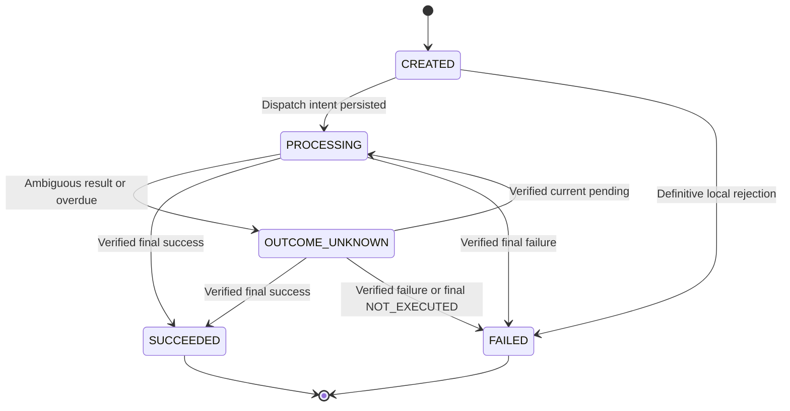
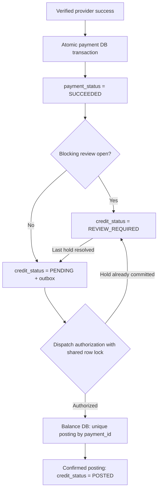
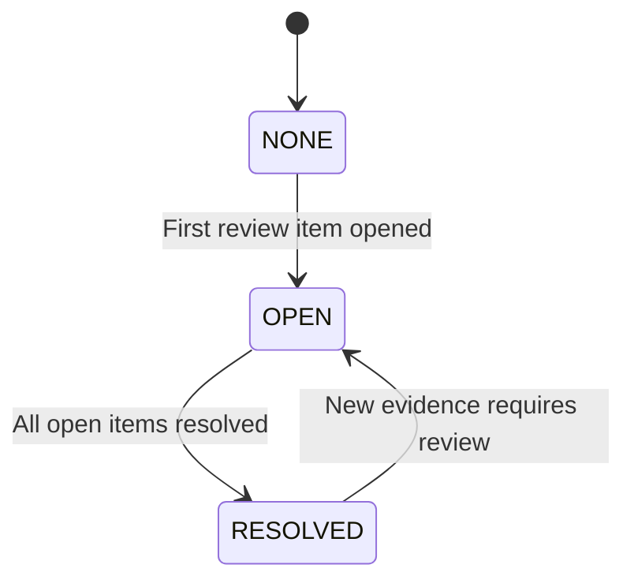
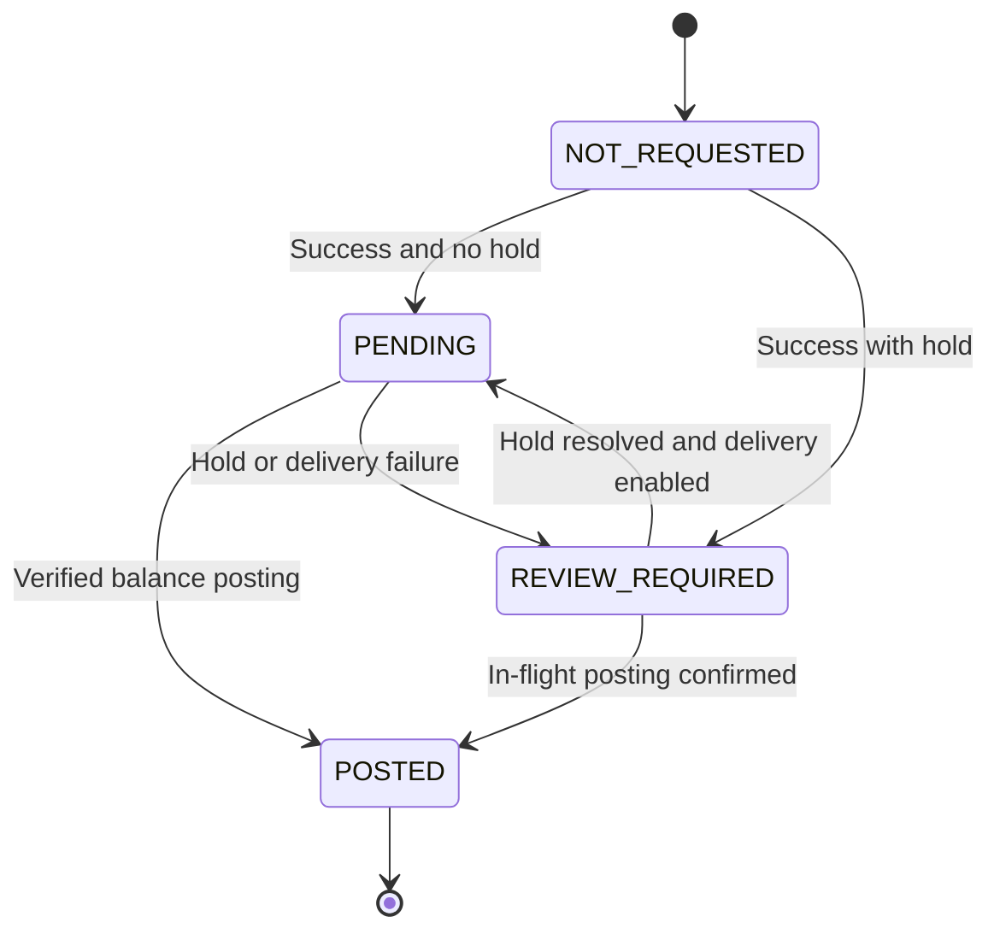

# Платёж после timeout: состояния, идемпотентность и восстановление

Series: Inside the Spec  
Subtitle: Real Scenarios. Working Artifacts. Decisions That Matter.  
Case: 01  
Author: Yulia Melekhova  
Version: 0.3  
Language: ru; технические идентификаторы на английском  
Status: Draft

## Назначение

Спецификация задаёт поведение пополнения баланса, когда результат обращения к платёжному провайдеру неизвестен. Используйте модели, правила и проверочные сценарии вместе: отдельно взятая диаграмма не задаёт полный контракт.

## Рабочая ситуация и границы

Пользователь пополняет баланс на €50: `amount_minor=5000`, `currency=EUR`. Create-запрос завершается timeout; провайдер мог принять платёж. Пользователь повторяет действие, а подтверждение может прийти позже через webhook или status lookup.

Это условный кейс с заданными ниже предпосылками. Он не описывает контракт конкретного провайдера, личный производственный инцидент или готовую к внедрению интеграцию. Все интервалы и лимиты являются проектными решениями кейса, без заявленных измерений.

В scope входят один провайдер, окончательные результаты платежа, неизвестный результат, повторные запросы, проверка статуса, ручной разбор, доставка задания на зачисление и контроль возможного дубликата с новым клиентским ключом.

### Предпосылки провайдера

| ID | Условие |
|---|---|
| PA-01 | Один provider key с одинаковыми параметрами соответствует одной операции. Провайдер обеспечивает это и для конкурентных запросов в пределах окна |
| PA-02 | Окно идемпотентности составляет 24 часа с первого принятого create-запроса; сетевой повтор не продлевает окно |
| PA-03 | Поиск доступен по стабильному `merchant_reference`; `NOT_FOUND` может быть временным и не доказывает отсутствие платежа |
| PA-04 | `SUCCEEDED` и `FAILED` окончательны для этой операции; refund и reversal оформляются отдельно |
| PA-05 | HTTP-ответ, webhook и lookup позволяют проверить принадлежность операции и её параметры |
| PA-06 | Webhook имеет стабильные `event_id` и тело события; каждая повторная доставка получает новые timestamp и подпись |
| PA-07 | Версия провайдерского состояния, если присутствует, сравнима между каналами. Без версии нельзя считать запоздалый `PENDING` актуальным только по времени получения |
| PA-08 | Автоматическое отрицательное закрытие требует финального NOT_EXECUTED и запрета будущего исполнения по reference; см. приложение F |

Перед реальным внедрением каждое условие проверяется по контракту выбранного провайдера.

## Артефакт 1. Payment State Machine

| Поле | Значения | Значение поля |
|---|---|---|
| `payment_status` | `CREATED`, `PROCESSING`, `OUTCOME_UNKNOWN`, `SUCCEEDED`, `FAILED` | Известный сервису результат платежа |
| `review_status` | `NONE`, `OPEN`, `RESOLVED` | Агрегат состояния разборов |
| `credit_status` | `NOT_REQUESTED`, `PENDING`, `POSTED`, `REVIEW_REQUIRED` | Состояние зачисления |



`PROCESSING` означает, что отправка могла начаться либо провайдер подтвердил обработку. Оно не доказывает списание. Намерение отправки сохраняется до сетевого вызова; сбой между этими действиями оставляет неоднозначную попытку.

`OUTCOME_UNKNOWN` не превращается в `FAILED` по таймеру, по `NOT_FOUND`, после исчерпания попыток или закрытия окна идемпотентности. Повтор create сам по себе не выводит операцию из `OUTCOME_UNKNOWN`.

Окончательные статусы автоматически не меняются. Противоречащий окончательный результат открывает разбор. Старый `PENDING` и запоздалый timeout не понижают финальное состояние.

### Связь платежа, разбора и зачисления



Основная связанная схема показывает проверку разбора и запуск зачисления при успехе платежа. Outbox находится в платёжной БД; проводка в БД баланса является отдельной транзакцией. CR-01/CR-02 задают атомарность и границу отправки.

## Артефакт 2. State Transition Table

Каждый обработчик проверяет доказательство результата, текущее состояние и версию операции. Обработка входящего подтверждения, изменение операции и создание outbox-записи выполняются в одной транзакции; допустима предварительная надёжная запись в inbox с последующей обработкой.

| ID | Из | Условие | В | Действие |
|---|---|---|---|---|
| ST-01 | Операции нет | Валидный новый ключ; duplicate guard разрешает | `CREATED` | Атомарно закрепить ключ, fingerprint и операцию |
| ST-02 | `CREATED` | Владелец отправки сохраняет намерение | `PROCESSING` | Сохранить reference, provider key и попытку до вызова |
| ST-03 | `CREATED` | Окончательный локальный отказ до намерения отправки | `FAILED` | Сохранить причину; внешнего вызова нет |
| ST-04 | `PROCESSING` | Timeout, неоднозначный ответ, недокументированный 5xx | `OUTCOME_UNKNOWN` | Сохранить классификацию; назначить lookup |
| ST-05 | `PROCESSING` | После сбоя найдена незавершённая попытка create | `OUTCOME_UNKNOWN` | Восстановление по прежним reference и key |
| ST-06 | `PROCESSING` / `OUTCOME_UNKNOWN` | Подтверждён окончательный успех | `SUCCEEDED` | Сохранить доказательство; применить credit gate из CR-01 |
| ST-07 | `PROCESSING` / `OUTCOME_UNKNOWN` | Подтверждён окончательный отказ | `FAILED` | Сохранить доказательство; зачисления нет |
| ST-08 | `OUTCOME_UNKNOWN` | Подтверждён актуальный `PENDING` | `PROCESSING` | Продолжить наблюдение; новый платёж не создавать |
| ST-09 | `PROCESSING` | Финального результата нет к следующему сроку проверки | `OUTCOME_UNKNOWN` | Выполнить lookup; при достижении часа открыть разбор |
| ST-10 | Нефинальное | Lookup: `NOT_FOUND`, timeout или ошибка | Без изменения | Ошибка lookup не определяет результат create |
| ST-11 | Любое | Тот же клиентский ключ и fingerprint | Без изменения | Вернуть PaymentStatus по API-01; POST 202 нефинальный / 200 финальный |
| ST-12 | Финальное | Повтор того же результата | Без изменения | Дедупликация; без повторного бизнес-действия |
| ST-13 | Финальное | Старый `PENDING` или timeout | Без изменения | Сохранить наблюдение |
| ST-14 | Финальное | Противоречащий финальный результат | Без изменения | Открыть `CONFLICTING_FINAL_RESULTS`; удержать ещё не начатое зачисление |
| ST-15 | Нефинальное | Нет результата через час или безопасное восстановление заблокировано | Без изменения | Открыть `RESULT_OVERDUE` либо `RECOVERY_BLOCKED`; исчерпание create-бюджета само по себе не прекращает lookup |
| ST-16 | Любое | Недостоверное сообщение или несовпадение параметров | Без изменения | Отклонить применение; зарегистрировать аномалию |
| ST-17 | Любое | Конфликт версии при конкурентной обработке | Повторная оценка | Перечитать операцию; применить исходное доказательство заново |
| ST-18 | Нефинальное | Проверенный финальный NOT_EXECUTED по PA-08 | `FAILED` | Атомарно сохранить доказательство, закрыть подтверждённые просрочку/сверку и снять guard; зачисления нет |

Актуальность `PENDING` подтверждается сравнимой версией провайдера либо документированным lookup с гарантией текущего состояния. Если ни одной гарантии нет, сохраняется наблюдение без перехода ST-08. Финальный результат всё равно проверяется по правилам PA-04 и ST-14.

## Артефакт 3. Idempotency Contract

### Идентичность операции

| Поле | Контракт |
|---|---|
| `client_idempotency_key` | Один ключ для одного намерения пополнить баланс; клиент сохраняет его при перезагрузке и сетевом сбое |
| Область ключа | `user_id + operation_type + client_idempotency_key` |
| `payment_id` | Один внутренний идентификатор операции |
| `request_fingerprint` | Канонические `amount_minor`, `currency`, `payment_instrument_id`; пользователь и тип операции заданы областью ключа |
| `provider_idempotency_key` | Сохраняется до первого вызова; одинаков для первоначального и повторного create |
| `merchant_reference` | Постоянная ссылка на операцию для lookup и сверки |
| `attempt_id` | Отдельный идентификатор каждого исходящего CREATE или LOOKUP |

Сумма задаётся целым числом в minor units; валюта нормализуется до согласованного кода в верхнем регистре. Инструмент является внутренним непрозрачным идентификатором. Fingerprint вычисляется по однозначной сериализации фиксированных полей, а не по произвольному исходному JSON. Изменение правил канонизации требует версионирования fingerprint.

| ID | Правило |
|---|---|
| IC-01 | Уникальность клиентского ключа обеспечивается ограничением хранилища |
| IC-02 | Ключ, fingerprint и операция фиксируются атомарно |
| IC-03 | Тот же ключ с другим fingerprint возвращает `409 IDEMPOTENCY_KEY_REUSED` |
| IC-04 | Тот же ключ и fingerprint возвращают PaymentStatus: POST 202 для любого нефинального состояния, POST 200 для финального; см. API-01 |
| IC-05 | Клиентский повтор не запускает дополнительный provider create |
| IC-06 | Восстановлением управляет один владелец операции; автоматические повторы HTTP-клиента, proxy и SDK отключены для create |
| IC-07 | При неизвестном результате перед разрешённым повтором выполняется lookup |
| IC-08 | Повтор использует прежние provider key и параметры; максимум два create-вызова всего, включая первоначальный |
| IC-09 | После локального cutoff автоматический create запрещён независимо от результата lookup |
| IC-10 | Без надёжной записи операции и резервирования попытки провайдер не вызывается |
| IC-11 | Сервис баланса атомарно обеспечивает не более одной проводки по `payment_id` |
| IC-12 | Новый клиентский ключ проверяется отдельным duplicate guard; один ключ не защищает от всех смысловых дубликатов |
| IC-13 | Перед повтором атомарно резервируется оставшийся create-бюджет и проверяются статус, владелец, блокировки и cutoff |

### Параметры восстановления

| Параметр | Значение в кейсе |
|---|---|
| Timeout CREATE / LOOKUP | 10 секунд на вызов |
| `recovery_started_at` | Время первого неизвестного результата или первой необходимости отложить create после подтверждённого непринятия |
| Lookup | Через 15 секунд, 1 минуту, 5 минут, 15 минут и 1 час от `recovery_started_at` |
| Пропущенные сроки | После рестарта одна актуальная проверка; пропущенные вызовы не отправляются пачкой |
| Create-бюджет | Первоначальный вызов и максимум один автоматический повтор; `429` расходует тот же бюджет |
| Повтор после unknown | Только после lookup `NOT_FOUND`, при открытом окне и отсутствии блокировок |
| Повтор после доказанного непринятия | Lookup необязателен только если все предшествующие попытки доказанно не создали операцию |
| Ограничение по времени | Повтор планируется до передачи по `RESULT_OVERDUE` через час; после открытия этого разбора автоматический create остановлен |
| Cutoff | Строго раньше `first_dispatch_at + 23 часа`; это дополнительная граница безопасности |
| Поздние события | Принимаются и проверяются после передачи оператору |
| Ручной lookup / сверка | Lookup оператора после часа; ежедневная сверка реестра по приложению F |
| Клиентский ключ | Хранится не менее 30 дней и до разрешения всех связанных неопределённостей, зачисления и разборов, если это дольше |

Cutoff в 23 часа оставляет запас относительно PA-02. Он безопасен только при подтверждённой семантике окна и ограничении задержки доставки повтора этим запасом. Если такую границу обеспечить нельзя, повтор create отключается; lookup и разбор сохраняются.

При доказанном непринятии `429` учитывается валидный `Retry-After`. Без него задержка единственного повтора составляет 2–4 секунды с jitter. Для unknown `429` Retry-After задаёт нижнюю границу повтора, но lookup всё равно обязателен. Если разрешённое время наступает после часа или cutoff, повтор отменяется.

Резервирование попытки расходует бюджет консервативно: сбой до сетевого вызова не даёт права автоматически вернуть этот слот. Потеря доступности предпочтительнее неучтённого дополнительного create.

### Ответы нашего API

| Ситуация | HTTP | Результат |
|---|---|---|
| Создана или повторена нефинальная операция | `202` | Существующий `payment_id`, три статуса и URL получения состояния |
| Повтор финальной операции | `200` | Тот же `payment_id`; успех платежа не обещает `credit_status=POSTED` |
| Существующий ключ с другими параметрами | `409` | `IDEMPOTENCY_KEY_REUSED` |
| Новый ключ заблокирован duplicate guard | `409` | `POSSIBLE_DUPLICATE_PAYMENT`, ID доступной этому пользователю исходной операции |
| Операцию нельзя надёжно сохранить | `503` | Внешнего вызова нет; клиент сохраняет прежний ключ |

При `503` из-за потери ответа commit операция уже могла сохраниться. Повтор с прежним ключом находит её; никакой провайдерский вызов не разрешён без подтверждённой долговременной записи. Ошибки аутентификации и базовой валидации обрабатываются до этой бизнес-логики.

### API-01. DTO ответа и поведение клиента

POST create и повтор с тем же ключом для `CREATED`, `PROCESSING`, `OUTCOME_UNKNOWN` всегда возвращают `202 Accepted` с единым DTO `PaymentStatus`. Финальный платёж возвращает `200 OK` с тем же DTO. Успешный `GET /payments/{payment_id}` возвращает `200 OK` для любого состояния платежа; клиент проверяет тело. Правила описывают снимок ответа, а не обещание неизменности статуса после его отправки.

Пример нефинального ответа:

```json
{
  "payment_id": "pay-001",
  "payment_status": "PROCESSING",
  "credit_status": "NOT_REQUESTED",
  "review_status": "NONE",
  "status_url": "/payments/pay-001",
  "next_action": "WAIT",
  "poll_after_seconds": 5,
  "retry_post": false
}
```

Все поля обязательны. Статусы используют enum из артефакта 1. `status_url` является относительным URL с проверкой доступа владельца. `next_action`: `CONTACT_SUPPORT` при открытом разборе; иначе `WAIT` при нефинальном платеже или ожидающемся зачислении; иначе `NONE`. `poll_after_seconds`: 5 для `WAIT`, иначе null. В ответе статуса `retry_post` всегда false: нужен GET, а не новый create. Инструкции интерфейсу не заменяют авторизацию и контроль конкурентности.

После корректного ответа 202 или 200 клиент прекращает повторы create. Опрос через GET выполняется не чаще раза в 5 секунд и максимум 60 секунд; затем останавливается, оставляя операцию видимой для последующего обновления. При `CONTACT_SUPPORT` или `NONE` опрос прекращается раньше. GET 200 сам по себе не означает успех платежа. Сетевая ошибка или 503 до получения ID допускает максимум один автоматический POST с прежним ключом, затем явное действие восстановления; новый ключ не создаётся. Известный ID восстанавливается через GET. Этот клиентский лимит независим от бюджета CREATE провайдера.

Ответ `409 POSSIBLE_DUPLICATE_PAYMENT`:

```json
{
  "error": "POSSIBLE_DUPLICATE_PAYMENT",
  "next_action": "SHOW_EXISTING_PAYMENT",
  "retry_post": false,
  "existing_operation": {
    "payment_id": "pay-001",
    "payment_status": "OUTCOME_UNKNOWN",
    "credit_status": "NOT_REQUESTED",
    "review_status": "OPEN",
    "status_url": "/payments/pay-001",
    "next_action": "CONTACT_SUPPORT",
    "poll_after_seconds": null,
    "retry_post": false
  }
}
```

`existing_operation` содержит полный снимок `PaymentStatus`, а не один ID. Интерфейс открывает исходную операцию и следует её инструкции; новый ключ не генерируется, второй запрос не показывается принятым. При конкурентном финальном результате снимок может устареть; GET обновляет его. Все ответы содержат `Cache-Control: no-store`; POST 202 также содержит `Location`, совпадающий с `status_url`. Ключ запроса и секреты не отражаются в ответе.

Выбор 202 с текущим статусом и ссылкой на монитор согласуется с [RFC 9110, раздел 15.3.3](https://www.rfc-editor.org/rfc/rfc9110.html#section-15.3.3). Лимиты опроса и поля DTO являются решениями кейса, а не требованиями RFC.

### Duplicate guard

Порядок: аутентификация и валидация, затем существующий клиентский ключ. Контроль применяется только к новому ключу. Повтор принятого ключа возвращает собственную операцию по API-01.

Новый ключ блокируется, пока у того же пользователя есть платёж с теми же инструментом, суммой и валютой в `CREATED`, `PROCESSING` или `OUTCOME_UNKNOWN`, независимо от возраста. Возвращается `409 POSSIBLE_DUPLICATE_PAYMENT` со снимком исходной операции по API-01 и `SHOW_EXISTING_PAYMENT`. Новая операция и связь отклонённого ключа не создаются. Истечения через пять минут и пользовательского обхода в этой версии нет.

Проверка и создание сериализованы долговременной блокировкой по пользователю, типу операции, инструменту, нормализованной сумме и валюте. Блокировка существует и при отсутствии совпадающих строк платежей. Создание и разрешение результата используют ту же блокировку: два новых ключа не проходят одновременно, а завершение не снимает защиту раньше commit. Освобождение блокировки не удаляет проверяемое условие незавершённости.

Контроль снимается только после доказанного `SUCCEEDED` или `FAILED`, включая окончательное `NOT_EXECUTED` по приложению F. Возраст, передача оператору и окончание окна его не снимают. Это сознательное ограничение доступности: одинаковое пополнение ждёт подтверждения. Разрешение намеренного второго одинакового платежа до разрешения первого потребовало бы отдельной политики.

Другие инструменты, суммы и новые пополнения после финального успеха остаются за границами контроля. Новый ключ после успеха также может быть смысловым дубликатом; интерфейс показывает завершённую операцию перед новым действием пополнения. Этот контроль не является полной защитой от мошенничества или всех повторных списаний.

## Артефакт 4. Idempotency Matrix

| ID | Сценарий | Ожидаемое поведение | Дополнительный CREATE |
|---|---|---|---|
| IM-01 | Новый ключ и валидные данные | Одна операция | Первоначальный |
| IM-02 | Повтор в `CREATED` | Тот же ID; первоначальную отправку подбирает владелец | Только ещё не выполненный первоначальный |
| IM-03 | Повтор в `PROCESSING` | `202`, PaymentStatus по API-01; клиент использует GET | Нет из-за повтора клиента |
| IM-04 | Повтор в `OUTCOME_UNKNOWN` | `202`, восстановление продолжается | Только по IC-07–IC-09 |
| IM-05 | Тот же ключ, другие параметры | `409 IDEMPOTENCY_KEY_REUSED` | Нет |
| IM-06 | Параллельные одинаковые запросы | Один ID | Один первоначальный |
| IM-07 | Параллельные разные payload с одним ключом | Один принят; другой получает `409` | Для принятой операции |
| IM-08 | Повтор после успеха | Тот же успех и статус зачисления | Нет |
| IM-09 | Повтор после отказа | Тот же отказ | Нет |
| IM-10 | Unknown, lookup `NOT_FOUND`, окно открыто | Unknown сохраняется до доказательства | Один, если бюджет свободен |
| IM-11 | Повтор create снова неоднозначен | Только lookup и входящие подтверждения | Нет |
| IM-12 | Lookup `NOT_FOUND` после cutoff | Unknown и разбор | Нет |
| IM-13 | Новый ключ совпадает с незавершённым платежом любого возраста | `409` со снимком PaymentStatus и SHOW_EXISTING_PAYMENT | Нет |
| IM-14 | Падение после отправки до ответа | Найти попытку; перейти к восстановлению | В пределах общего бюджета |
| IM-15 | Два recovery-воркера | Одна зарезервированная попытка | В пределах общего бюджета |
| IM-16 | Успех во время подготовки повтора | Отменить ещё не начатую отправку, если успех уже виден; обработать результат | Уже отправленный повтор безопасен только по PA-01 |
| IM-17 | Повтор webhook успеха | Одна обработка, одно логическое задание | Нет |
| IM-18 | Платёж успешен, зачисление не завершено | Восстанавливать зачисление по `payment_id` | Нет |
| IM-19 | Хранилище недоступно до сохранения | `503`, вызова нет | Нет |
| IM-20 | Связь старого клиентского ключа законно удалена | Запрос может быть новым; guard проверяется заново | Возможен первоначальный |
| IM-21 | Доказанно непринятый `429` | Отложить с Retry-After; сохранить бюджет | Максимум один повтор |
| IM-22 | Webhook и lookup дают один успех | Один переход и одно логическое задание | Нет |
| IM-23 | Webhook и lookup дают разные финалы | Первый допустимый финал сохранён; конфликт открыт | Нет |
| IM-24 | Поздний успех при `RESULT_OVERDUE` | Успех; закрыть только просрочку; оценить другие причины | Нет |
| IM-25 | Новый ключ через 6 минут или 24 часа; прежний unknown | Контроль сохраняется; вернуть исходную операцию | Нет |

## Приложение A. Жизненный цикл разбора



`review_status` является агрегатом набора `review_items`. У каждой записи есть `review_id`, `payment_id`, `reason`, `status`, `owner`, `opened_at`, `next_action_at`, `resolved_at`, `resolution_code`, ссылки на доказательства и журнал действий. Пока открыта хотя бы одна причина, агрегат равен `OPEN`; при отсутствии истории равен `NONE`; после закрытия всех причин равен `RESOLVED`.

| Причина | Владелец | Блокирует зачисление | Разрешение |
|---|---|---|---|
| `RESULT_OVERDUE` | Payment Operations | Нет сама по себе | Автоматически при проверенном финальном результате |
| `RECOVERY_BLOCKED` | Payment Operations | Нет сама по себе | Оператор устраняет препятствие; финальное подтверждение закрывает только причину неизвестного результата, но не дефект конфигурации |
| `CONFLICTING_FINAL_RESULTS` | Payment Operations | Да, если зачисление ещё не началось | Проверка доказательств; обычный обработчик финал не исправляет |
| `PARAMETER_MISMATCH` | Payment Operations | Да | Сверка принадлежности, суммы и валюты |
| `SECURITY_HOLD` | Security Operations | Да | Уполномоченный сотрудник снимает блокировку с обоснованием |
| `CREDIT_DELIVERY_FAILED` | Balance Operations | До устранения причины | Восстановление задания и подтверждение проводки |

Первое действие владельца планируется не позднее 30 минут после открытия. Просрочка вызывает операционный сигнал. Это целевой параметр кейса, а не обещание фактического времени разрешения.

Поздний проверенный финал может изменить нефинальный `payment_status`, даже если разбор открыт. Он автоматически закрывает только `RESULT_OVERDUE` с основанием `AUTO_PROVIDER_CONFIRMATION`. Другие причины сохраняются. Недостоверный webhook сам по себе не открывает блокирующий разбор для произвольно указанного платежа: это позволило бы злоумышленнику блокировать зачисления. Блокировка требует доверенной связи с операцией и отдельного основания.

Оператор не назначает успех без доказательства провайдера. Изменение уже финального результата требует отдельной процедуры исправления с полномочиями и аудитом; эта процедура находится вне текущей модели.

## Приложение B. Классификация ошибок провайдера

| Ответ CREATE | Известный факт | Решение |
|---|---|---|
| `429` с контрактной гарантией непринятия | Эта попытка не создала операцию | Один отложенный повтор, если предыдущие попытки также не оставили unknown |
| `429` без гарантии | Результат неизвестен | ST-04; lookup перед возможным повтором |
| `502`, `503`, `504`, обрыв, timeout, повреждённый ответ | Без отдельной гарантии результат неизвестен | ST-04; lookup и общий create-бюджет |
| Документированный окончательный отказ с гарантией отсутствия операции | Доказан бизнес-отказ | `FAILED` |
| Конфликт provider key | Возможна существующая операция или несовпадение параметров | Lookup; при несовпадении разбор, без нового key |
| Ошибка авторизации/конфигурации | Вызов требует операционного вмешательства | Остановить create-повторы; проверить семантику. Если непринятие не доказано, unknown |

HTTP-код сам по себе не доказывает результат платежа. Доказанное непринятие второй попытки не отменяет неизвестность первой. Ошибка LOOKUP характеризует проверку статуса и не переводит платёж в `FAILED`.

## Приложение C. Webhook Contract

Это выбранный контракт условного провайдера, без утверждения о поддержке таких заголовков реальными платёжными API.

| Элемент | Правило |
|---|---|
| Канал | HTTPS; ограничение тела 64 KiB до бизнес-разбора |
| Заголовки | `X-Webhook-Key-Id`, `X-Webhook-Timestamp`, `X-Webhook-Signature` |
| Timestamp | Целое Unix-время доставки в секундах; принимается при отклонении не более 300 секунд |
| Подписываемые байты | ASCII(timestamp), затем один байт точки `0x2E`, затем исходные байты HTTP-тела |
| Подпись | HMAC-SHA256; hex из 64 символов; после декодирования сравнение за постоянное время |
| Payload | Обязательный непустой `event_id` в подписанном теле, merchant account, payment ID, reference, amount, currency, status; event version при наличии |
| Секрет | Secret manager; отдельные значения для сред и endpoints; не входит в логи |
| Ротация | Key ID выбирает активный или предыдущий ключ; предыдущий принимается максимум 24 часа после активации нового |
| Дедупликация | Уникальная пара `provider + event_id`; fingerprint исходного тела |
| Retention | Inbox и dedup-маркеры не менее 30 дней и до закрытия связанных операций/разборов, если дольше |

Порядок: ограничить размер, проверить заголовки и timestamp, проверить подпись исходных байтов, разобрать payload, сопоставить merchant и операцию, надёжно сохранить inbox. Подтверждение `2xx` выдаётся после durable save, а не после зачисления. При недоступности inbox возвращается `503`; при неверной подписи или timestamp `401`; при некорректном payload `400`; при превышении размера `413`.

Отсутствующий, пустой или некорректный `event_id` является ошибкой схемы: вернуть `400`, не применять событие, восстанавливать результат через доверенный lookup. Кейс не поддерживает провайдеров без постоянной подписанной идентичности события. Повтор той же валидной доставки в пределах 300 секунд упирается в уникальность inbox и не повторяет бизнес-действия. Хэш тела вместе с timestamp доставки не заменяет идентичность: timestamp меняется при законной повторной доставке. Хэш тела выявляет конфликт payload, а не создаёт идентификатор бизнес-события.

Точный повтор уже сохранённого события получает `2xx`. Если один event ID имеет другое тело при валидной подписи, оба доказательства сохраняются, второе не меняет платёж автоматически и регистрируется аномалия. При надёжной записи карантина возвращается `2xx`, чтобы не создавать бесконечную повторную доставку.

Свежая подпись не делает событие актуальным по бизнес-смыслу. Старое событие с новой доставкой допустимо; переход оценивается по ST-08 и ST-12–ST-14. После истечения retention дедупликации повтор всё равно ограничен состояниями и уникальностью проводки, но прежняя гарантия распознавания event ID заканчивается.

## Приложение D. Зачисление и Outbox

### CR-01. Credit gate

На подтверждённом успехе:

1. Установить `payment_status=SUCCEEDED` и сохранить доказательство.
2. Если открыта блокирующая причина, установить `credit_status=REVIEW_REQUIRED`; автоматического разрешения на зачисление нет.
3. Если блокировки нет, установить `credit_status=PENDING` и создать одно логическое задание `CreditRequested(payment_id)` в той же транзакции.

Снятие последней блокирующей причины для успешного платежа атомарно переводит `REVIEW_REQUIRED` в `PENDING` и обеспечивает существование одного логического задания. Повторное открытие блокировки удерживает ещё не начатое задание; проверки только при создании outbox недостаточно.



Воркер атомарно резервирует отправку с повторной проверкой блокирующих причин. Эта транзакция является границей, после которой вызов считается начатым. Если разбор открыт позднее, уже начатый внешний вызов может создать проводку. Статус `POSTED` отражает подтверждённый факт и не откатывается из-за открытия разбора. Если нужна строгая блокировка вплоть до commit проводки, сервис баланса должен участвовать в отдельном протоколе разрешения; он вне scope.

| Событие | Поведение |
|---|---|
| Timeout или 5xx сервиса баланса | Повтор с прежним `payment_id` |
| Проводка создана, ответ потерян | Повтор возвращает существующую проводку; статус становится `POSTED` |
| Воркер упал после обработки | Lease истекает; другой воркер повторяет безопасную доставку |
| Постоянная ошибка данных | `REVIEW_REQUIRED`, остановка доставки, `CREDIT_DELIVERY_FAILED` |
| Недоступность длится 24 часа | Сохранить задание в ручной очереди; не удалять |
| Проводка с тем же ID, но другой суммой | Ошибка целостности, ручной разбор; существующую проводку не менять |

Сервис баланса атомарно создаёт проводку и защищает уникальность `payment_id`; повтор проверяет также сумму, валюту и получателя. Outbox обеспечивает повторную доставку, а не уникальность финансового эффекта сам по себе.

### CR-02. Локальная атомарность и граница отправки

Только обновление платежа и вставка outbox объединены локальной транзакцией платёжной БД. Проводка позже создаётся другой транзакцией в БД баланса; общая атомарность между БД, distributed transaction или Saga здесь не заявлены. Финансовый эффект защищён надёжной повторной доставкой и атомарной дедупликацией в балансе по `payment_id`.

Чтение или захват outbox-задания ещё не разрешает вызов баланса. Перед отправкой воркер открывает локальную транзакцию, блокирует строку платежа, перечитывает все блокирующие причины и атомарно сохраняет попытку доставки как `DISPATCH_AUTHORIZED`. Любое открытие/закрытие hold также блокирует ту же строку платежа. Поэтому порядок commit определён:

| Порядок commit | Обязательное поведение |
|---|---|
| Hold раньше разрешения отправки | Баланс не вызывается; зачисление остаётся на разборе, даже если воркер раньше прочитал задание |
| Разрешение отправки раньше hold | Эта попытка может исполниться; hold запрещает последующие попытки, но не отзывает разрешённую |

Логическая граница начала в кейсе является commit разрешения, а не обычным чтением очереди или физической отправкой. При падении воркера после разрешения без результата попытка доставки остаётся неоднозначной. Позднее подтверждённая проводка фиксируется и при hold; повторная отправка при открытом hold запрещена. Lookup на стороне баланса может установить наличие проводки; без такой возможности при hold нужен ручной разбор.

Разрыв соединения до первого ответа зачисления не доказывает, создана ли проводка. Без hold повторяется ровно то же задание с прежним `payment_id`: баланс возвращает существующую проводку либо атомарно создаёт одну. Timeout не делает платёж неуспешным и не позволяет пометить задание доставленным.

Контракт не обещает, что hold после разрешения предотвратит физический вызов или финансовый commit. Строгий отзыв требует протокола авторизации/ограждения на стороне баланса. Эта более сильная гарантия остаётся за границами кейса; дополнительное локальное чтение её не обеспечивает.

Backoff: первая задержка 2 секунды; далее `min(300, 2 * 2^(n-1))` секунд для повтора n. Jitter выбирается в пределах 50–100% рассчитанной задержки. Общий лимит исходящих вызовов к балансу для кейса: 10 в секунду и не более 10 одновременно; воркеры делят лимит, не умножают его.

Circuit breaker открывается после пяти подряд timeout/5xx, не вызывает сервис 30 секунд, затем допускает одну пробу. Успешный ответ закрывает breaker; повторный timeout/5xx открывает его снова. Остановки breaker и рестарты не сбрасывают возраст задания. При общем отказе создаётся один операционный инцидент с обновлением счётчика затронутых операций.

Целевой SLO: 99,9% успешных платежей без блокирующих разборов в момент фиксации успеха получают проводку в течение 60 секунд за календарный месяц. Знаменатель включает такие платежи независимо от сбоев воркера или сервиса баланса. Последующие блокировки также не исключают их задним числом. Для исключённых платежей публикуются отдельные число и возраст, без сокрытия задержек.

Это выбранная цель кейса, ещё не подтверждённая нагрузочными или эксплуатационными данными. SLA пользователю не заявлен. Через 2 минуты после успеха без проводки создаётся предупреждение. Интерфейс различает «Платёж подтверждён. Зачисление обрабатывается» и «Платёж подтверждён. Зачисление проверяется». Ошибка зачисления не меняет платёж на `FAILED`.

## Приложение E. Попытки, inbox и конкурентность

### Модель попыток

| Группа | Поля |
|---|---|
| Идентичность | `attempt_id`, `payment_id`, `operation_type=CREATE/LOOKUP`, `attempt_number` |
| Причина | `trigger`, `owner_token`, `next_retry_at` |
| Трассировка | `trace_id`, `correlation_id`, `provider_request_id` при наличии |
| Время | `started_at`, `finished_at`, `duration_ms` |
| Результат | `http_status`, `provider_error_code`, `transport_outcome`, `result_classification` |
| Жизненный цикл | `STARTED`, `COMPLETED`, `UNRESOLVED` |

Запись `STARTED` сохраняется перед вызовом. Ответ переводит попытку в `COMPLETED`, даже если её классификация равна `AMBIGUOUS`: завершённость сетевой попытки не означает известность результата платежа. При утрате воркера незавершённая запись становится `UNRESOLVED`. Поздний ответ дополняет ту же запись и проходит общую проверку результата.

Отправки зачисления имеют собственную историю доставки с `outbox_id`, `delivery_attempt_id` и ссылкой на `payment_id`. Входящие webhook хранятся в inbox, а не в `payment_attempts`. В логах запрещены секреты, платёжные реквизиты и полные чувствительные payload.

### Порядок конкурентной обработки

1. Надёжно сохранить подтверждение с идентификатором источника. Для webhook используется `provider + event_id`, для ответа CREATE/LOOKUP связь с `attempt_id`.
2. В транзакции прочитать операцию и активные review items; проверить принадлежность и допустимость перехода.
3. Атомарно применить изменение с проверкой версии, обеспечить outbox при необходимости и отметить подтверждение обработанным.
4. При конфликте версии откатить транзакцию, перечитать данные и повторно оценить то же подтверждение. Оно не теряется после одного неудачного compare-and-set.

| Гонка | Результат |
|---|---|
| Lookup `PENDING` и webhook success | Итог `SUCCEEDED`; `PENDING` не понижает финал |
| Два success из разных каналов | Один переход, одно логическое задание, одна проводка |
| Failure и success | Первый допустимый финал остаётся; второй открывает конфликт. Уже проведённые деньги не отменяются автоматически |
| Timeout и success | Success сохраняется независимо от порядка commit |
| Оператор закрывает overdue одновременно с webhook | Версионирование и повторная оценка; закрывается только разрешённая причина |
| Lease recovery истёк во время запроса | Новый владелец не запускает конкурентный CREATE только по факту истечения lease; неопределённая попытка требует lookup и правил восстановления |

Локальные lease и версии не способны отозвать уже начатый сетевой запрос. Возможное пересечение старого и разрешённого повторного вызова защищается PA-01, одинаковым provider key и общим числом зарезервированных попыток. Без провайдерской конкурентной идемпотентности автоматический повтор при unknown выключается.

## Приложение F. Реестр сверки и закрытие неизвестного результата

Сверка сопоставляет незавершённые локальные операции с доверенными подтверждениями провайдера. Реестр ведётся отдельно от `payment_status`: административный статус очереди не создаёт финансовый результат.

PA-08 является дополнительной возможностью, необходимой для автоматического отрицательного закрытия в кейсе: провайдер выдаёт окончательное авторитетное подтверждение `NOT_EXECUTED` по merchant account и reference, покрывающее все попытки create и provider key. Подтверждается как отсутствие исполнения, так и невозможность будущего исполнения, включая задержанные запросы. Провайдер отклоняет будущие create по закрытой reference даже после истечения окна идемпотентности. Это явное условие условного кейса, а не предполагаемая функция реальных провайдеров. Без него или эквивалентного проверенного финального доказательства отрицательное закрытие недоступно.

| ID | Правило |
|---|---|
| RC-01 | Через час без результата создать или обновить единственный кейс сверки по `payment_id`; владелец Payment Operations. Автоматический create остановлен; duplicate guard сохраняется |
| RC-02 | Ежедневный запуск в 02:00 UTC (09:00 Bangkok). Выбирать все незавершённые кейсы, включая старые; отдельно полученные финальные подтверждения применять сразу |
| RC-03 | Сохранять run ID, ID и версию источника/отчёта, merchant, интервал/watermark, проверки полноты, ссылку на доказательство и время загрузки. Повтор запуска идемпотентен по идентичности источника/доказательства |
| RC-04 | Проверенный SUCCESS/FAILURE применяет ST-06/ST-07. Успех проходит прежние review и credit gate; противоречие сохранённому финалу применяет ST-14 |
| RC-05 | Отсутствующая строка, NOT_FOUND, неполный отчёт и окончание окна не означают FAILED. Сохранять unknown, владельца и следующее действие |
| RC-06 | Проверенный NOT_EXECUTED по PA-08 переводит нефинальный платёж в FAILED с `failure_reason=PROVIDER_CONFIRMED_NOT_EXECUTED`; доказательство сохраняется, duplicate guard снимается атомарно |
| RC-07 | Через 24 часа от начала восстановления передать нерешённый кейс руководителю Payment Operations и запросить расследование провайдера; следующее действие оператора в течение 4 часов. Ежедневная сверка продолжается |
| RC-08 | Возраст 7 дней создаёт инцидент с владельцем платежа и эскалацией провайдеру. Финансовый статус и duplicate guard по возрасту не меняются |

Поля реестра: `reconciliation_case_id`, `payment_id`, `owner`, `case_status=OPEN/ESCALATED/RESOLVED`, `opened_at`, `next_action_at`, `last_checked_at`, `evidence_refs`, `resolution_code`. Архивирование тикета не делает нерешённый кейс RESOLVED. Разрешение кейса и подтверждённый переход платежа фиксируются атомарно; независимые разборы безопасности или конфигурации остаются открытыми.

Для NOT_EXECUTED проверяются merchant, reference, все сохранённые попытки, подлинность, полнота/окончательность подтверждения и запрет будущего исполнения. Файл только проведённых settlement-операций недостаточен: в нём могут отсутствовать ожидающие и задержанные платежи. Недостоверные и противоречащие подтверждения направляются в карантин. Поздний успех после удостоверенного отрицательного закрытия является нарушением контракта и обрабатывается как ST-14, без скрытого изменения FAILED.

Таким образом, unknown имеет путь к финальному успеху, отказу или удостоверенному неисполнению и ответственного за эскалацию при отсутствии данных. Безусловный срок перехода в FAILED обещать нельзя. Chargeback является отдельным процессом оспаривания, а не способом установить результат неизвестного create.

## Проверочные сценарии и трассировка

Это спецификация ожидаемого поведения, не отчёт о выполнении тестов реализации.

| ID | Given / When | Then | Связь |
|---|---|---|---|
| AC-01 | Два одновременных запроса с одним ключом и данными | Один `payment_id`, один первоначальный CREATE | IC-01–IC-06, IM-06 |
| AC-02 | Тот же ключ; сумма 5000 заменена на 6000 | `409`; исходная операция неизменна | IC-03, IM-05 |
| AC-03 | CREATE timeout, lookup `NOT_FOUND`, единственный повтор тоже timeout | Unknown; ровно два зарезервированных CREATE; дальнейших CREATE нет | ST-04, IC-08, IM-11 |
| AC-04 | Первый CREATE unknown; повтор получил доказанно непринятый `429` | Unknown сохраняется; третьего CREATE нет | Приложение B, IC-08 |
| AC-05 | Первый CREATE доказанно не принят с `429`; Retry-After=30 секунд | Не повторять раньше 30 секунд; тот же provider key | IC-08, IM-21 |
| AC-06 | Retry-After уводит повтор за час или cutoff | CREATE не выполняется; разбор и наблюдение сохраняются | IC-09, ST-15 |
| AC-07 | Lookup `NOT_FOUND` после 24 часов | Unknown; никакого нового provider key и CREATE | ST-10, IM-12 |
| AC-08 | Открыт только overdue; приходит проверенный success | `SUCCEEDED`; overdue закрыт; одно задание на зачисление | ST-06, IM-24, CR-01 |
| AC-09 | Одновременно открыты overdue и security hold; приходит success | `SUCCEEDED`; overdue закрыт, security hold открыт; credit review | Приложение A, CR-01 |
| AC-10 | Снят последний hold у успешного платежа | `PENDING`; одно логическое задание, включая повторную обработку команды | CR-01 |
| AC-11 | Неверная подпись webhook с известным payment ID | Платёж и его блокировки неизменны; `401` и событие безопасности | ST-16, Приложение C |
| AC-12 | Событие старше суток; доставлено со свежей валидной подписью | Возраст бизнес-события сам по себе не причина отказа | Приложение C |
| AC-13 | Валидный webhook повторён с новым timestamp, теми же ID и телом | `2xx`; бизнес-действие не повторяется | ST-12, IM-17 |
| AC-14 | Два разных подписанных payload с одним event ID | Сохранён конфликт; второй не применяется автоматически | Приложение C |
| AC-15 | Inbox недоступен | `503`; уведомление не считается принятым | Приложение C |
| AC-16 | Одновременно success и `PENDING` | Итог success, одна проводка | ST-13, ST-17, IM-22 |
| AC-17 | Одновременно подтверждённые success и failure | Один финал; конфликт открыт; автоматического отката проводки нет | ST-14, IM-23 |
| AC-18 | Баланс создал проводку; ответ потерян; доставка повторилась | Одна проводка, затем `POSTED` | IC-11, Приложение D |
| AC-19 | Воркер упал после commit success до отправки задания | Задание сохранено; рестарт возобновляет доставку | ST-06, CR-01 |
| AC-20 | Outbox уже создан; hold открыт до резервирования отправки | Вызова баланса нет; `REVIEW_REQUIRED` | CR-01 |
| AC-21 | Hold открыт после начала вызова баланса; проводка подтверждена | `POSTED`, разбор остаётся; обещания отозвать вызов нет | Приложение D |
| AC-22 | Два новых ключа с одинаковыми признаками приходят одновременно при незавершённом исходном платеже | Одна операция; второй запрос `409 POSSIBLE_DUPLICATE_PAYMENT` | Duplicate guard, IM-13 |
| AC-23 | Новый ключ через 6 минут; первый платёж unknown | По-прежнему 409; вернуть PaymentStatus, второго платежа нет | IM-25, API-01 |
| AC-24 | Хранилище недоступно до резервирования попытки | Провайдер не вызывается | IC-10 |
| AC-25 | Воркер потерян после записи попытки и до сетевого вызова | Слот бюджета не возвращается автоматически; попытка unresolved | IC-13, Приложение E |
| AC-26 | Прошло 30 дней, но открыт разбор или нет подтверждённой проводки | Связь клиентского ключа не удаляется | Retention |
| AC-27 | Сервис баланса дал пять последовательных 5xx | Breaker открыт; задания сохранены; проба через 30 секунд | Приложение D |
| AC-28 | Воркеры недоступны 10 минут после success | Сохранён платёж; просроченное зачисление учитывается как нарушение SLO, если входит в знаменатель | Приложение D |
| AC-29 | POST-повтор возвращает каждое нефинальное состояние | 202 и полный DTO API-01; клиент прекращает POST и использует ограниченный GET | API-01, IC-04, ST-11 |
| AC-30 | GET возвращает известный нефинальный платёж | 200 с тем же DTO; HTTP 200 не является финансовым успехом | API-01 |
| AC-31 | Duplicate guard отклоняет новый ключ | 409 с existing_operation и SHOW_EXISTING_PAYMENT; связи нового ключа нет | API-01, IM-13 |
| AC-32 | Совпадающий платёж unknown уже 24 часа | Контроль сохраняется; новый ключ не создаёт второй CREATE | IM-25 |
| AC-33 | Воркер прочитал задание; hold commit раньше разрешения | Общая блокировка строки задаёт порядок; баланс не вызывается | CR-02 |
| AC-34 | Отправка разрешена; hold commit до физической отправки | Разрешённая попытка может исполниться; строгий отзыв не заявлен | CR-02 |
| AC-35 | Первый ответ баланса потерян; hold отсутствует | Повтор с прежним payment_id; максимум одна проводка | CR-02, IC-11 |
| AC-36 | Подписанный webhook без event_id | 400, событие не применяется; доверенный lookup для восстановления | Приложение C |
| AC-37 | Перехваченная валидная доставка повторена в пределах 300 секунд | Та же идентичность inbox; бизнес-эффект не повторяется | Приложение C |
| AC-38 | В ежедневном отчёте нет строки либо он неполный | Сохранить unknown, guard, владельца и следующее действие | RC-05 |
| AC-39 | Финальный NOT_EXECUTED покрывает все попытки и закрывает reference | FAILED с доказательством; атомарно снять guard и разрешить кейс | PA-08, ST-18, RC-06 |
| AC-40 | Ежедневная сверка повторена либо возраст кейса достиг 7 дней | Эффекты разрешения не дублируются; возраст даёт эскалацию, а не отказ | RC-03, RC-08 |

## Beyond the Scope

| Смежный процесс | Почему нужна отдельная спецификация |
|---|---|
| Authorization / capture | Успешная авторизация не означает выполненный capture |
| 3DS | Нужны ожидание действия пользователя и возврат после подтверждения |
| Refund / reversal | Отдельная операция может иметь собственный неизвестный результат |
| Chargeback | Оспаривание возникает после зачисления и использования денег |
| Частичные операции | Нужны суммы частей и контроль остатка |
| Конвертация | Нужны валюты, курс, округление и правила сверки |
| Failover между провайдерами | Ключ одного провайдера не предотвращает списание у другого |
| Дубликаты за пределами guard | Другие суммы/инструменты и новые намерения после финального успеха требуют отдельной бизнес-политики |
| Исправление финального результата | Нужны полномочия, доказательства, финансовые корректировки и аудит |
| Адаптеры сверки провайдера | Реестр включён в scope; реальные форматы отчётов, settlement-исключения и гарантии доказательств требуют интеграционной спецификации |
| Строгий hold на стороне баланса | Нужен протокол разрешения проводки, если локальной проверки перед отправкой недостаточно |

Темы отмечены как продолжение без обещания конкретной даты.

## Изменения и статус проверки

Версия 0.3 добавляет API-01 с единым DTO и ограниченным опросом клиента; guard до доказанного разрешения платежа; порядок локальных hold/dispatch по CR-02; обязательную подписанную идентичность события; связанную основную схему; приложение F с ответственной сверкой и условным отрицательным закрытием. AC-23 теперь блокирует прежний обход через шесть минут. Комплект содержит четыре основных артефакта, шесть приложений и 40 проверочных сценариев.

Обе языковые спецификации и карусели обновляются вместе. Автоматические проверки документов и визуальная проверка PDF не являются тестами реализации. Возможности провайдера, нагрузочные результаты и измеренный SLO не заявлены. PA-08 требует подтверждения; без него отсутствие строки в отчёте не закрывает unknown как FAILED.

---

Inside the Spec · Real Scenarios. Working Artifacts. Decisions That Matter.  
https://github.com/YuliaMelekhova/inside-the-spec  
https://www.linkedin.com/in/yuliamelekhova
