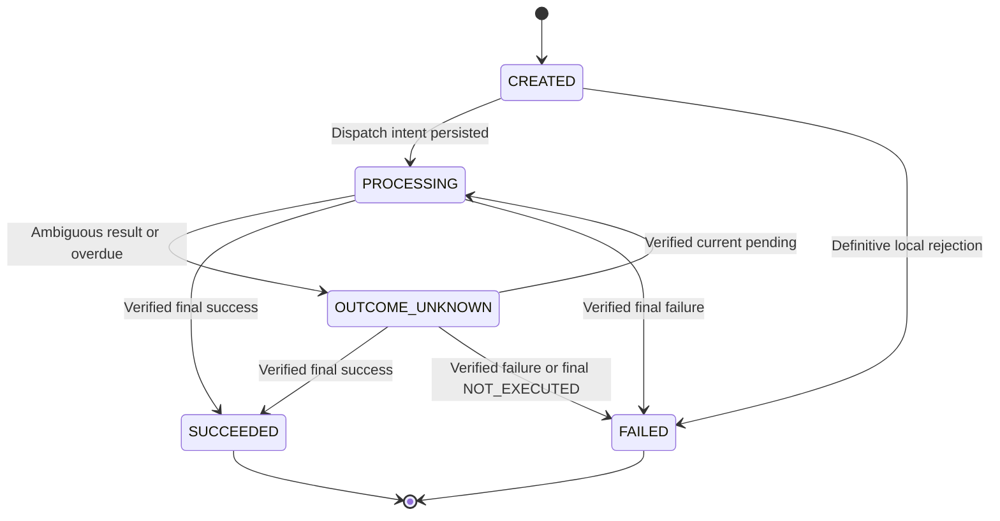
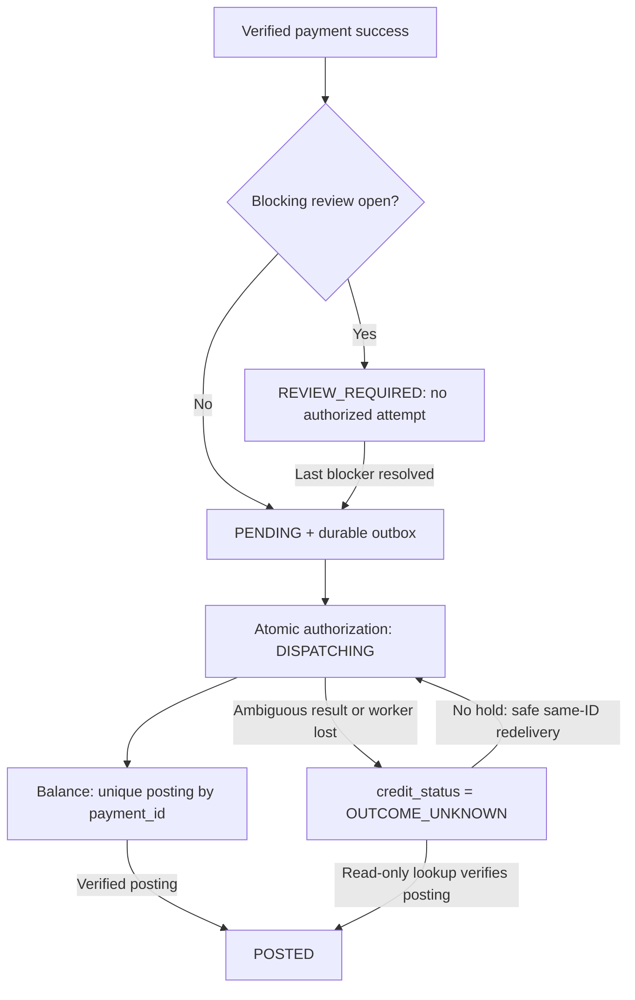
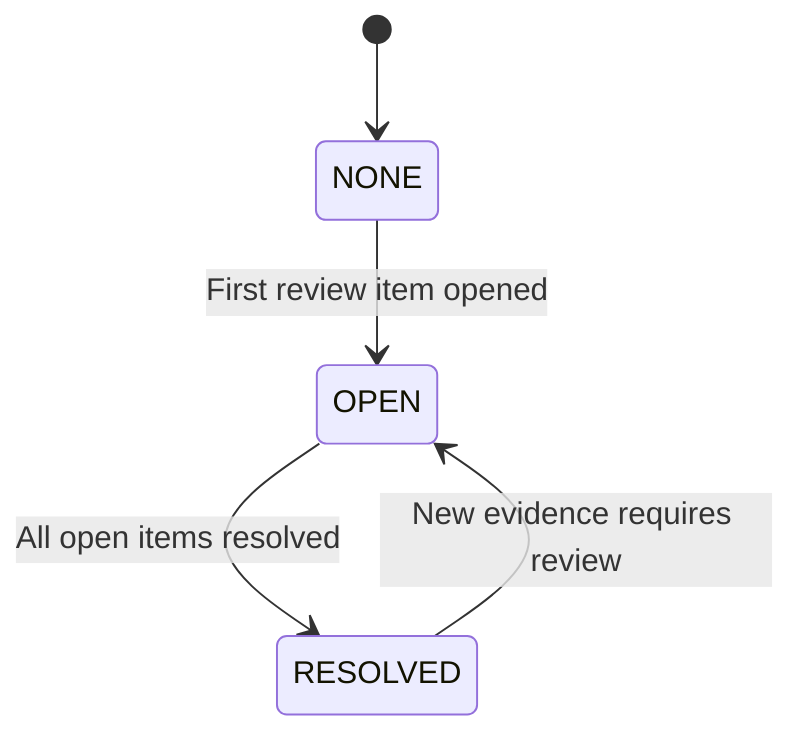
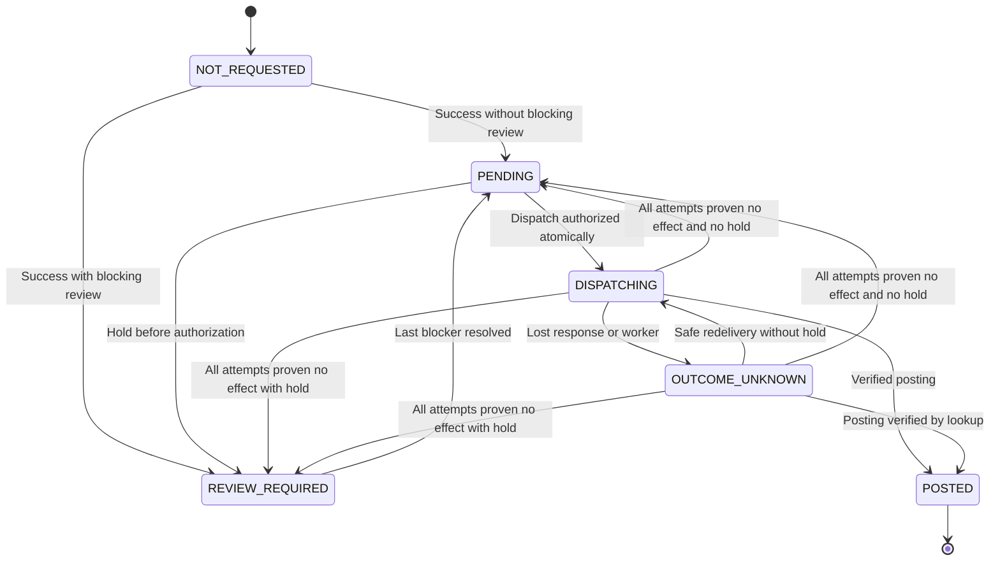

# Платёж после timeout: состояния, идемпотентность и восстановление

Series: Inside the Spec  
Subtitle: Realistic Scenarios. Working Artifacts. Decisions That Matter.  
Case: 01  
Author: Yulia Melekhova  
Version: 0.4  
Language: ru; технические идентификаторы на английском  
Status: Draft

## Назначение

Спецификация задаёт поведение пополнения баланса, когда результат обращения к платёжному провайдеру неизвестен. Используйте модели, правила и проверочные сценарии вместе: отдельно взятая диаграмма не задаёт полный контракт.

## Рабочая ситуация и границы

Пользователь пополняет баланс на €50: `amount_minor=5000`, `currency=EUR`. Create-запрос завершается timeout; провайдер мог принять платёж. Пользователь повторяет действие, а подтверждение может прийти позже через webhook или status lookup.

Это условный кейс с заданными ниже предпосылками. Он не описывает контракт конкретного провайдера, личный производственный инцидент или готовую к внедрению интеграцию. Все интервалы и лимиты являются проектными решениями кейса, без заявленных измерений.

В scope входят один провайдер, окончательные результаты платежа, неизвестный результат, повторные запросы, проверка статуса, ручной разбор, доставка задания на зачисление и контроль возможного дубликата с новым клиентским ключом.


Инструмент в этом кейсе выполняется без действий пользователя; €50 является иллюстративной суммой, а не утверждением о карточном платеже в ЕС или освобождении от SCA. Сценарии с 3DS/SCA challenge требуют отдельной спецификации.

### Предпосылки провайдера

| ID | Условие |
|---|---|
| PA-01 | Один provider key с одинаковыми параметрами соответствует одной операции. Провайдер обеспечивает это и для конкурентных запросов в пределах окна |
| PA-02 | Окно идемпотентности составляет 24 часа с первого принятого create-запроса; сетевой повтор не продлевает окно |
| PA-03 | Поиск доступен по стабильному `merchant_reference`; `NOT_FOUND` может быть временным и не доказывает отсутствие платежа |
| PA-04 | `SUCCEEDED` и `FAILED` окончательны для этой операции; refund и reversal оформляются отдельно |
| PA-05 | HTTP-ответ, webhook и lookup позволяют проверить принадлежность операции и её параметры |
| PA-06 | Webhook имеет стабильные `event_id` и тело события; каждая повторная доставка получает новые timestamp и подпись |
| PA-07 | Версия провайдерского состояния, если присутствует, сравнима между каналами. Без версии нельзя считать запоздалый `PENDING` актуальным только по времени получения |
| PA-08 | Автоматическое отрицательное закрытие требует финального NOT_EXECUTED и запрета будущего исполнения по reference; см. приложение F |

Перед реальным внедрением каждое условие проверяется по контракту выбранного провайдера.

## Артефакт 1. Payment State Machine

| Поле | Значения | Значение поля |
|---|---|---|
| `payment_status` | `CREATED`, `PROCESSING`, `OUTCOME_UNKNOWN`, `SUCCEEDED`, `FAILED` | Известный сервису результат платежа |
| `review_status` | `NONE`, `OPEN`, `RESOLVED` | Агрегат состояния разборов |
| `credit_status` | `NOT_REQUESTED`, `PENDING`, `DISPATCHING`, `OUTCOME_UNKNOWN`, `REVIEW_REQUIRED`, `POSTED` | Состояние зачисления |



`PROCESSING` означает, что отправка могла начаться либо провайдер подтвердил обработку. Оно не доказывает списание. Намерение отправки сохраняется до сетевого вызова; сбой между этими действиями оставляет неоднозначную попытку.

`OUTCOME_UNKNOWN` не превращается в `FAILED` по таймеру, по `NOT_FOUND`, после исчерпания попыток или закрытия окна идемпотентности. Повтор create сам по себе не выводит операцию из `OUTCOME_UNKNOWN`.

Окончательные статусы автоматически не меняются. Противоречащий окончательный результат открывает разбор. Старый `PENDING` и запоздалый timeout не понижают финальное состояние.

### Связь платежа, разбора и зачисления



Основная связанная схема показывает проверку разбора и запуск зачисления при успехе платежа. Outbox находится в платёжной БД; проводка в БД баланса является отдельной транзакцией. CR-01/CR-02 задают атомарность и границу отправки.

### M-01. Связанные статусы и допустимые сочетания

Это связанные измерения состояния, а не независимые автоматы. Полный enum `credit_status`: `NOT_REQUESTED`, `PENDING`, `DISPATCHING`, `OUTCOME_UNKNOWN`, `REVIEW_REQUIRED`, `POSTED`. Указывайте поле рядом с `OUTCOME_UNKNOWN`: неизвестный результат платежа и неизвестный результат зачисления являются разными фактами.

`review_items` является единственным источником причин разбора. `review_status` и `blocking_review_reasons` вычисляются в одном снимке операции. Второе поле содержит открытые причины, запрещающие новые отправки зачисления. `credit_status` отражает ход зачисления и подтверждённые факты; это не второй редактируемый флаг удержания. Обработчик определяет его под блокировкой строки платежа. `RESULT_OVERDUE` и `RECOVERY_BLOCKED` сами по себе не блокируют зачисление; `SECURITY_HOLD`, `PARAMETER_MISMATCH`, `CONFLICTING_FINAL_RESULTS` и `CREDIT_DELIVERY_FAILED` блокируют.

| payment_status | credit_status | Открытая блокирующая причина | Значение / ограничение |
|---|---|---|---|
| CREATED / PROCESSING / OUTCOME_UNKNOWN | NOT_REQUESTED | Любое значение | До подтверждённого успеха платежа зачисление не разрешено |
| FAILED | NOT_REQUESTED | Любое значение | Отказавший платёж не зачисляется; FAILED + POSTED запрещено |
| SUCCEEDED | PENDING | Нет | Задание готово; ни одна разрешённая попытка уже не может создать проводку |
| SUCCEEDED | REVIEW_REQUIRED | Есть | Новая отправка запрещена; ни одна разрешённая попытка уже не может создать проводку |
| SUCCEEDED | DISPATCHING | Любое значение | Разрешённая попытка активна; последующий hold её не отзывает |
| SUCCEEDED | OUTCOME_UNKNOWN | Любое значение | Разрешённая попытка могла создать проводку; hold запрещает новые отправки, но не сверку чтением |
| SUCCEEDED | POSTED | Любое значение | Проводка подтверждена; последующий разбор этот факт не отменяет |

Другие сочетания payment/credit запрещены. Без блокирующей причины `review_status=OPEN` совместим с `credit_status=PENDING` только для неблокирующего разбора, например неустранённой ошибки конфигурации после успеха платежа. При блокирующей причине `review_status` обязан быть OPEN. Без открытых причин он равен NONE или RESOLVED в зависимости от истории. Успех и credit gate фиксируются атомарно, поэтому SUCCEEDED + NOT_REQUESTED не является зафиксированным состоянием.

Открытие блокирующей причины переводит неначатое PENDING в REVIEW_REQUIRED. Оно не заменяет DISPATCHING, OUTCOME_UNKNOWN или POSTED. Снятие последнего hold переводит REVIEW_REQUIRED в PENDING; неизвестное зачисление остаётся неизвестным до подтверждения либо безопасной доставки. Переходы заданы в CR-01–CR-04.

`provider_operation_seen` является сохраняемым монотонным boolean. Любое проверенное PENDING либо финальное подтверждение провайдера атомарно устанавливает true, даже если версия PENDING слишком стара для изменения `payment_status`. После true любые новые разрешения CREATE провайдера запрещены, включая последующие NOT_FOUND и timeout. PROCESSING может означать неопределённость отправки либо подтверждённую обработку; допуск create определяет этот явный факт, а не только название статуса.

## Артефакт 2. State Transition Table

Каждый обработчик проверяет доказательство результата, текущее состояние и версию операции. Обработка входящего подтверждения, изменение операции и создание outbox-записи выполняются в одной транзакции; допустима предварительная надёжная запись в inbox с последующей обработкой.

| ID | Из | Условие | В | Действие |
|---|---|---|---|---|
| ST-01 | Операции нет | Валидный новый ключ; duplicate guard разрешает | `CREATED` | Атомарно закрепить ключ, fingerprint и операцию |
| ST-02 | `CREATED` | Владелец отправки сохраняет намерение | `PROCESSING` | Сохранить reference, provider key и попытку до вызова |
| ST-03 | `CREATED` | Окончательный локальный отказ до намерения отправки | `FAILED` | Сохранить причину; внешнего вызова нет |
| ST-04 | `PROCESSING` | Timeout, неоднозначный ответ, недокументированный 5xx | `OUTCOME_UNKNOWN` | Сохранить классификацию; назначить lookup |
| ST-05 | `PROCESSING` | После сбоя найдена незавершённая попытка create | `OUTCOME_UNKNOWN` | Восстановление по прежним reference и key |
| ST-06 | `PROCESSING` / `OUTCOME_UNKNOWN` | Подтверждён окончательный успех | `SUCCEEDED` | Сохранить доказательство; применить credit gate из CR-01 |
| ST-07 | `PROCESSING` / `OUTCOME_UNKNOWN` | Подтверждён окончательный отказ | `FAILED` | Сохранить доказательство; зачисления нет |
| ST-08 | `OUTCOME_UNKNOWN` | Подтверждён актуальный `PENDING` | `PROCESSING` | Сохранить provider_operation_seen=true; продолжить наблюдение; любые новые разрешения CREATE запрещены |
| ST-09 | `PROCESSING` | Финального результата нет к следующему сроку проверки | `OUTCOME_UNKNOWN` | Выполнить lookup; при достижении часа открыть разбор |
| ST-10 | Нефинальное | Lookup: `NOT_FOUND`, timeout или ошибка | Без изменения | Ошибка lookup не определяет результат create |
| ST-11 | Любое | Тот же клиентский ключ и fingerprint | Без изменения | Вернуть PaymentStatus по API-01; POST 202 нефинальный / 200 финальный |
| ST-12 | Финальное | Повтор того же результата | Без изменения | Дедупликация; без повторного бизнес-действия |
| ST-13 | Финальное | Старый `PENDING` или timeout | Без изменения | Сохранить наблюдение |
| ST-14 | Финальное | Противоречащий финальный результат | Без изменения | Открыть `CONFLICTING_FINAL_RESULTS`; удержать ещё не начатое зачисление |
| ST-15 | Нефинальное | Нет результата через час или безопасное восстановление заблокировано | Без изменения | Открыть `RESULT_OVERDUE` либо `RECOVERY_BLOCKED`; исчерпание create-бюджета само по себе не прекращает lookup |
| ST-16 | Любое | Недостоверное сообщение или несовпадение параметров | Без изменения | Отклонить применение; зарегистрировать аномалию |
| ST-17 | Любое | Конфликт версии при конкурентной обработке | Повторная оценка | Перечитать операцию; применить исходное доказательство заново |
| ST-18 | Нефинальное | Проверенный финальный NOT_EXECUTED по PA-08 | `FAILED` | Атомарно сохранить доказательство, закрыть подтверждённые просрочку/сверку и снять guard; зачисления нет |

Актуальность `PENDING` подтверждается сравнимой версией провайдера либо документированным lookup с гарантией текущего состояния. Если ни одной гарантии нет, сохраняется наблюдение без перехода ST-08. Финальный результат всё равно проверяется по правилам PA-04 и ST-14.

## Артефакт 3. Idempotency Contract

### Идентичность операции

| Поле | Контракт |
|---|---|
| `client_idempotency_key` | Один ключ для одного намерения пополнить баланс; клиент сохраняет его при перезагрузке и сетевом сбое |
| Область ключа | `user_id + operation_type + client_idempotency_key` |
| `payment_id` | Один внутренний идентификатор операции |
| `request_fingerprint` | Канонические `amount_minor`, `currency`, `payment_instrument_id`; пользователь и тип операции заданы областью ключа |
| `provider_idempotency_key` | Сохраняется до первого вызова; одинаков для первоначального и повторного create |
| `merchant_reference` | Постоянная ссылка на операцию для lookup и сверки |
| `attempt_id` | Отдельный идентификатор каждого исходящего CREATE или LOOKUP |

Сумма задаётся целым числом в minor units; валюта нормализуется до согласованного кода в верхнем регистре. Инструмент является внутренним непрозрачным идентификатором. Fingerprint вычисляется по однозначной сериализации фиксированных полей, а не по произвольному исходному JSON. Изменение правил канонизации требует версионирования fingerprint.

| ID | Правило |
|---|---|
| IC-01 | Уникальность клиентского ключа обеспечивается ограничением хранилища |
| IC-02 | Ключ, fingerprint и операция фиксируются атомарно |
| IC-03 | Тот же ключ с другим fingerprint возвращает `409 IDEMPOTENCY_KEY_REUSED` |
| IC-04 | Тот же ключ и fingerprint возвращают PaymentStatus: POST 202 для любого нефинального состояния, POST 200 для финального; см. API-01 |
| IC-05 | Клиентский повтор не запускает дополнительный provider create |
| IC-06 | Восстановлением управляет один владелец операции; автоматические повторы HTTP-клиента, proxy и SDK отключены для create |
| IC-07 | При неизвестном результате перед разрешённым повтором выполняется lookup |
| IC-08 | Прежние provider key и параметры; максимум два резерва create всего с первичным; новый резерв запрещён при provider_operation_seen=true |
| IC-09 | После локального cutoff автоматический create запрещён независимо от результата lookup |
| IC-10 | Без надёжной записи операции и резервирования попытки провайдер не вызывается |
| IC-11 | Сервис баланса атомарно обеспечивает не более одной проводки по `payment_id` |
| IC-12 | Новый клиентский ключ проверяется отдельным duplicate guard; один ключ не защищает от всех смысловых дубликатов |
| IC-13 | Перед повтором атомарно резервируется оставшийся create-бюджет и проверяются статус, владелец, блокировки и cutoff |
| IC-14 | Проверенный факт существования операции устанавливает provider_operation_seen=true навсегда; любое последующее разрешение CREATE запрещено |

### Параметры восстановления

| Параметр | Значение в кейсе |
|---|---|
| Timeout CREATE / LOOKUP | 10 секунд на вызов |
| `recovery_started_at` | Фиксированный T0 при первой неоднозначности, проверенном нефинальном ответе либо отложенном create после доказанного непринятия; RP-01 |
| Lookup | Через 15 секунд, 1 минуту, 5 минут, 15 минут и 1 час от `recovery_started_at` |
| Пропущенные сроки | После рестарта одна актуальная проверка; пропущенные вызовы не отправляются пачкой |
| Create-бюджет | Первоначальный вызов и максимум один автоматический повтор; `429` расходует тот же бюджет |
| Повтор после unknown | Только после lookup `NOT_FOUND`, при открытом окне и отсутствии блокировок |
| Повтор после доказанного непринятия | Lookup необязателен только если все предшествующие попытки доказанно не создали операцию |
| Ограничение по времени | Повтор планируется до передачи по `RESULT_OVERDUE` через час; после открытия этого разбора автоматический create остановлен |
| Cutoff | Строго раньше `first_dispatch_at + 23 часа`; это дополнительная граница безопасности |
| Поздние события | Принимаются и проверяются после передачи оператору |
| Ручной lookup / сверка | Lookup оператора после часа; ежедневная сверка реестра по приложению F |
| Клиентский ключ | Весь срок хранения операции; минимум создание +30 дней и последнее полное разрешение +30 дней; см. KEY-01 |

Cutoff в 23 часа оставляет запас относительно PA-02. Он безопасен только при подтверждённой семантике окна и ограничении задержки доставки повтора этим запасом. Если такую границу обеспечить нельзя, повтор create отключается; lookup и разбор сохраняются.

При доказанном непринятии `429` учитывается валидный `Retry-After`. Без него задержка единственного повтора составляет 2–4 секунды с jitter. Для unknown `429` Retry-After задаёт нижнюю границу повтора, но lookup всё равно обязателен. Если разрешённое время наступает после часа или cutoff, повтор отменяется.

Резервирование попытки расходует бюджет консервативно: сбой до сетевого вызова не даёт права автоматически вернуть этот слот. Потеря доступности предпочтительнее неучтённого дополнительного create.

### RP-01. Часы восстановления и безопасность create

T0 является сохранённым recovery_started_at и однократно фиксируется при первой неоднозначности, первом проверенном нефинальном ответе провайдера либо первом отложенном create после доказанного непринятия. Все сроки lookup являются абсолютными смещениями от T0: T0+15 секунд, T0+60 секунд, T0+300 секунд, T0+900 секунд, T0+3600 секунд. Это не интервалы после предыдущего вызова. Каждый вызов может длиться до 10 секунд. Независимый deadline T0+3600 секунд открывает просрочку и запрещает CREATE до запуска последнего lookup, не ожидая его завершения. Опоздавший планировщик делает одну актуальную проверку вместо пачки; T0 не сбрасывается.

При неоднозначном предыдущем CREATE основная гарантия финансовой безопасности: PA-01, прежний provider key и параметры обозначают одну операцию даже при конкурентной доставке. NOT_FOUND является только условием допуска повтора, а не доказательством неисполнения. Путь без lookup требует договорного доказательства непринятия всех прежних попыток. Ни одно из этих условий не заменяет PA-01 при неизвестном результате. Для обоих путей атомарно проверяются provider_operation_seen=false, общий бюджет, владелец, блокировки и оба срока. Последующий NOT_FOUND никогда не сбрасывает provider_operation_seen.

Часовой deadline является действующим лимитом повтора в обычном случае; first_dispatch_at+23 часа является внешним защитным ограничением, обычно недостижимым. Ручной путь также не может обойти этот внешний срок. Без подтверждённой конкурентной идемпотентности и ограниченного времени доставки внутри окна неоднозначные CREATE-повторы отключаются, наблюдение и сверка сохраняются.

### KEY-01. Хранение и истечение клиентского ключа

Область ключа, версия/значение fingerprint и payment_id хранятся весь срок хранения операции. Минимум: 30 дней от создания и 30 дней после последнего разрешения неизвестности платежа, неизвестности/доставки зачисления и всех разборов, что наступит позже. У неразрешённых операций нет TTL, включая возраст 7 дней и окончание окна провайдера. Задания и ключи восстанавливаются вместе; очистка атомарно проверяет финальный платёж, завершённый жизненный цикл зачисления и закрытые разборы. Данные GET/статуса и связь повтора доступны одновременно. Только после законного удаления операции и связи старый ключ может считаться новым; пожизненный replay после удаления не обещается. Политика хранения документируется в API, клиент не должен намеренно переиспользовать старые ключи.

### Ответы нашего API

| Ситуация | HTTP | Результат |
|---|---|---|
| Создана или повторена нефинальная операция | `202` | Существующий `payment_id`, три статуса и URL получения состояния |
| Повтор финальной операции | `200` | Тот же `payment_id`; успех платежа не обещает `credit_status=POSTED` |
| Существующий ключ с другими параметрами | `409` | `IDEMPOTENCY_KEY_REUSED` |
| Новый ключ заблокирован duplicate guard | `409` | `POSSIBLE_DUPLICATE_PAYMENT`, ID доступной этому пользователю исходной операции |
| Операцию нельзя надёжно сохранить | `503` | Внешнего вызова нет; клиент сохраняет прежний ключ |

При `503` из-за потери ответа commit операция уже могла сохраниться. Повтор с прежним ключом находит её; никакой провайдерский вызов не разрешён без подтверждённой долговременной записи. Ошибки аутентификации и базовой валидации обрабатываются до этой бизнес-логики.

### API-01. DTO ответа и поведение клиента

POST create и повтор с тем же ключом для `CREATED`, `PROCESSING`, `OUTCOME_UNKNOWN` всегда возвращают `202 Accepted` с единым DTO `PaymentStatus`. Финальный платёж возвращает `200 OK` с тем же DTO. Успешный `GET /payments/{payment_id}` возвращает `200 OK` для любого состояния платежа; клиент проверяет тело. Правила описывают снимок ответа, а не обещание неизменности статуса после его отправки.

Пример нефинального ответа:

```json
{
  "payment_id": "pay-001",
  "payment_status": "PROCESSING",
  "credit_status": "NOT_REQUESTED",
  "review_status": "NONE",
  "blocking_review_reasons": [],
  "status_url": "/payments/pay-001",
  "next_action": "WAIT",
  "poll_after_seconds": 5,
  "retry_post": false
}
```

Все поля, включая вычисляемый массив blocking_review_reasons ниже, обязательны. Статусы используют enum из артефакта 1. `status_url` является относительным URL с проверкой доступа владельца. `next_action` определяется блокирующими причинами и политикой восстановления ниже, а не только review_status. `poll_after_seconds`: 5 для `WAIT`, иначе null. В ответе статуса `retry_post` всегда false: нужен GET, а не новый create. Инструкции интерфейсу не заменяют авторизацию и контроль конкурентности.

После корректного ответа 202 или 200 клиент прекращает повторы create. Опрос через GET выполняется не чаще раза в 5 секунд и максимум 60 секунд; затем останавливается, оставляя операцию видимой для последующего обновления. При `CONTACT_SUPPORT` или `NONE` опрос прекращается раньше. GET 200 сам по себе не означает успех платежа. Сетевая ошибка или 503 до получения ID допускает максимум один автоматический POST с прежним ключом, затем явное действие восстановления; новый ключ не создаётся. Известный ID восстанавливается через GET. Этот клиентский лимит независим от бюджета CREATE провайдера.

Ответ `409 POSSIBLE_DUPLICATE_PAYMENT`:

```json
{
  "error": "POSSIBLE_DUPLICATE_PAYMENT",
  "next_action": "SHOW_EXISTING_PAYMENT",
  "retry_post": false,
  "existing_operation": {
    "payment_id": "pay-001",
    "payment_status": "OUTCOME_UNKNOWN",
    "credit_status": "NOT_REQUESTED",
    "review_status": "OPEN",
    "blocking_review_reasons": [],
    "status_url": "/payments/pay-001",
    "next_action": "CONTACT_SUPPORT",
    "poll_after_seconds": null,
    "retry_post": false
  }
}
```

`existing_operation` содержит полный снимок `PaymentStatus`, а не один ID. Интерфейс открывает исходную операцию и следует её инструкции; новый ключ не генерируется, второй запрос не показывается принятым. При конкурентном финальном результате снимок может устареть; GET обновляет его. Все ответы содержат `Cache-Control: no-store`; POST 202 также содержит `Location`, совпадающий с `status_url`. Ключ запроса и секреты не отражаются в ответе.

Выбор 202 с текущим статусом и ссылкой на монитор согласуется с [RFC 9110, раздел 15.3.3](https://www.rfc-editor.org/rfc/rfc9110.html#section-15.3.3). Лимиты опроса и поля DTO являются решениями кейса, а не требованиями RFC.

DTO также обязательно содержит blocking_review_reasons, вычисленные по открытым review_items в том же снимке. Сам по себе неблокирующий OPEN не означает удержание зачисления. WAIT включает credit PENDING, DISPATCHING и OUTCOME_UNKNOWN при активном автоматическом восстановлении. CONTACT_SUPPORT используется при блокирующем разборе либо передаче операционистам; NONE означает отсутствие необходимого действия пользователя. При неизвестном зачислении с hold показываются неизвестность и пауза новых отправок, а не утверждение «не зачислено».

Правило кнопки: повторять POST с прежним ключом можно только без полученного валидного ответа со статусом или ID операции и в пределах клиентского бюджета. После 202/200 PaymentStatus либо existing_operation кнопка «Повторить» заменяется на «Проверить статус» через GET того же платежа. Новое намерение не создаётся.

Выбор HTTP: кейс осознанно использует 409 при изменении данных и 202 с PaymentStatus при повторе незавершённого запроса. Это отличается от рабочего [черновика IETF Idempotency-Key draft-07, раздел 2.7](https://www.ietf.org/archive/id/draft-ietf-httpapi-idempotency-key-header-07.html#section-2.7), рекомендующего соответственно 422 и 409. Соответствие этому отображению ошибок черновика не заявляется.

### Duplicate guard

Порядок: аутентификация и валидация, затем существующий клиентский ключ. Контроль применяется только к новому ключу. Повтор принятого ключа возвращает собственную операцию по API-01.

Новый ключ блокируется, пока у того же пользователя есть платёж с теми же инструментом, суммой и валютой в `CREATED`, `PROCESSING` или `OUTCOME_UNKNOWN`, независимо от возраста. Возвращается `409 POSSIBLE_DUPLICATE_PAYMENT` со снимком исходной операции по API-01 и `SHOW_EXISTING_PAYMENT`. Новая операция и связь отклонённого ключа не создаются. Истечения через пять минут и пользовательского обхода в этой версии нет.

Проверка и создание сериализованы долговременной блокировкой по пользователю, типу операции, инструменту, нормализованной сумме и валюте. Блокировка существует и при отсутствии совпадающих строк платежей. Создание и разрешение результата используют ту же блокировку: два новых ключа не проходят одновременно, а завершение не снимает защиту раньше commit. Освобождение блокировки не удаляет проверяемое условие незавершённости.

Контроль снимается только после доказанного `SUCCEEDED` или `FAILED`, включая окончательное `NOT_EXECUTED` по приложению F. Возраст, передача оператору и окончание окна его не снимают. Это сознательное ограничение доступности: одинаковое пополнение ждёт подтверждения. Разрешение намеренного второго одинакового платежа до разрешения первого потребовало бы отдельной политики.

Другие инструменты, суммы и новые пополнения после финального успеха остаются за границами контроля. Новый ключ после успеха также может быть смысловым дубликатом; интерфейс показывает завершённую операцию перед новым действием пополнения. Этот контроль не является полной защитой от мошенничества или всех повторных списаний.

## Артефакт 4. Idempotency Matrix

Шесть минут в IM-25 / AC-23 являются примером возраста за пределами прежней пятиминутной версии, а не текущим сроком истечения. В этой версии возраст не снимает guard.

| ID | Сценарий | Ожидаемое поведение | Дополнительный CREATE |
|---|---|---|---|
| IM-01 | Новый ключ и валидные данные | Одна операция | Первоначальный |
| IM-02 | Повтор в `CREATED` | Тот же ID; первоначальную отправку подбирает владелец | Только ещё не выполненный первоначальный |
| IM-03 | Повтор в `PROCESSING` | `202`, PaymentStatus по API-01; клиент использует GET | Нет из-за повтора клиента |
| IM-04 | Повтор в `OUTCOME_UNKNOWN` | `202`, восстановление продолжается | Только по IC-07–IC-09 |
| IM-05 | Тот же ключ, другие параметры | `409 IDEMPOTENCY_KEY_REUSED` | Нет |
| IM-06 | Параллельные одинаковые запросы | Один ID | Один первоначальный |
| IM-07 | Параллельные разные payload с одним ключом | Один принят; другой получает `409` | Для принятой операции |
| IM-08 | Повтор после успеха | Тот же успех и статус зачисления | Нет |
| IM-09 | Повтор после отказа | Тот же отказ | Нет |
| IM-10 | Unknown, lookup `NOT_FOUND`, окно открыто | Unknown сохраняется до доказательства | Один, если бюджет свободен |
| IM-11 | Повтор create снова неоднозначен | Только lookup и входящие подтверждения | Нет |
| IM-12 | Lookup `NOT_FOUND` после cutoff | Unknown и разбор | Нет |
| IM-13 | Новый ключ совпадает с незавершённым платежом любого возраста | `409` со снимком PaymentStatus и SHOW_EXISTING_PAYMENT | Нет |
| IM-14 | Падение после отправки до ответа | Найти попытку; перейти к восстановлению | В пределах общего бюджета |
| IM-15 | Два recovery-воркера | Одна зарезервированная попытка | В пределах общего бюджета |
| IM-16 | Успех во время подготовки повтора | Отменить ещё не начатую отправку, если успех уже виден; обработать результат | Уже отправленный повтор безопасен только по PA-01 |
| IM-17 | Повтор webhook успеха | Одна обработка, одно логическое задание | Нет |
| IM-18 | Платёж успешен, зачисление не завершено | Восстанавливать зачисление по `payment_id` | Нет |
| IM-19 | Хранилище недоступно до сохранения | `503`, вызова нет | Нет |
| IM-20 | Связь старого клиентского ключа законно удалена | Запрос может быть новым; guard проверяется заново | Возможен первоначальный |
| IM-21 | Доказанно непринятый `429` | Отложить с Retry-After; сохранить бюджет | Максимум один повтор |
| IM-22 | Webhook и lookup дают один успех | Один переход и одно логическое задание | Нет |
| IM-23 | Webhook и lookup дают разные финалы | Первый допустимый финал сохранён; конфликт открыт | Нет |
| IM-24 | Поздний успех при `RESULT_OVERDUE` | Успех; закрыть только просрочку; оценить другие причины | Нет |
| IM-25 | Новый ключ через 6 минут или 24 часа; прежний unknown | Контроль сохраняется; вернуть исходную операцию | Нет |

## Приложение A. Жизненный цикл разбора



`review_status` является агрегатом набора `review_items`. У каждой записи есть `review_id`, `payment_id`, `reason`, `status`, `owner`, `opened_at`, `next_action_at`, `resolved_at`, `resolution_code`, ссылки на доказательства и журнал действий. Пока открыта хотя бы одна причина, агрегат равен `OPEN`; при отсутствии истории равен `NONE`; после закрытия всех причин равен `RESOLVED`.

| Причина | Владелец | Блокирует зачисление | Разрешение |
|---|---|---|---|
| `RESULT_OVERDUE` | Payment Operations | Нет сама по себе | Автоматически при проверенном финальном результате |
| `RECOVERY_BLOCKED` | Payment Operations | Нет сама по себе | Оператор устраняет препятствие; финальное подтверждение закрывает только причину неизвестного результата, но не дефект конфигурации |
| `CONFLICTING_FINAL_RESULTS` | Payment Operations | Да для новых отправок; разрешённая попытка не отзывается | Проверка доказательств; обычный обработчик финал не исправляет |
| `PARAMETER_MISMATCH` | Payment Operations | Да | Сверка принадлежности, суммы и валюты |
| `SECURITY_HOLD` | Security Operations | Да | Уполномоченный сотрудник снимает блокировку с обоснованием |
| `CREDIT_DELIVERY_FAILED` | Balance Operations | До устранения причины | Восстановление задания и подтверждение проводки |

Первое действие владельца планируется не позднее 30 минут после открытия. Просрочка вызывает операционный сигнал. Это целевой параметр кейса, а не обещание фактического времени разрешения.

Поздний проверенный финал может изменить нефинальный `payment_status`, даже если разбор открыт. Он автоматически закрывает только `RESULT_OVERDUE` с основанием `AUTO_PROVIDER_CONFIRMATION`. Другие причины сохраняются. Недостоверный webhook сам по себе не открывает блокирующий разбор для произвольно указанного платежа: это позволило бы злоумышленнику блокировать зачисления. Блокировка требует доверенной связи с операцией и отдельного основания.

Оператор не назначает успех без доказательства провайдера. Изменение уже финального результата требует отдельной процедуры исправления с полномочиями и аудитом; эта процедура находится вне текущей модели.

## Приложение B. Классификация ошибок провайдера

| Ответ CREATE | Известный факт | Решение |
|---|---|---|
| `429` с контрактной гарантией непринятия | Эта попытка не создала операцию | Один отложенный повтор, если предыдущие попытки также не оставили unknown |
| `429` без гарантии | Результат неизвестен | ST-04; lookup перед возможным повтором |
| `502`, `503`, `504`, обрыв, timeout, повреждённый ответ | Без отдельной гарантии результат неизвестен | ST-04; lookup и общий create-бюджет |
| Документированный окончательный отказ с гарантией отсутствия операции | Доказан бизнес-отказ | `FAILED` |
| Конфликт provider key | Возможна существующая операция или несовпадение параметров | Lookup; при несовпадении разбор, без нового key |
| Ошибка авторизации/конфигурации | Вызов требует операционного вмешательства | Остановить create-повторы; проверить семантику. Если непринятие не доказано, unknown |

HTTP-код сам по себе не доказывает результат платежа. Доказанное непринятие второй попытки не отменяет неизвестность первой. Ошибка LOOKUP характеризует проверку статуса и не переводит платёж в `FAILED`.

## Приложение C. Webhook Contract

Это выбранный контракт условного провайдера, без утверждения о поддержке таких заголовков реальными платёжными API.

| Элемент | Правило |
|---|---|
| Канал | HTTPS; ограничение тела 64 KiB до бизнес-разбора |
| Заголовки | `X-Webhook-Key-Id`, `X-Webhook-Timestamp`, `X-Webhook-Signature` |
| Timestamp | Целое Unix-время доставки в секундах; принимается при отклонении не более 300 секунд |
| Подписываемые байты | ASCII(timestamp), затем один байт точки `0x2E`, затем исходные байты HTTP-тела |
| Подпись | HMAC-SHA256; hex из 64 символов; после декодирования сравнение за постоянное время |
| Payload | Обязательный непустой `event_id` в подписанном теле, merchant account, payment ID, reference, amount, currency, status; event version при наличии |
| Секрет | Secret manager; отдельные значения для сред и endpoints; не входит в логи |
| Ротация | Key ID выбирает активный или предыдущий ключ; предыдущий принимается максимум 24 часа после активации нового |
| Дедупликация | Уникальная пара `provider + event_id`; fingerprint исходного тела |
| Retention | Inbox и dedup-маркеры не менее 30 дней и до закрытия связанных операций/разборов, если дольше |

Порядок: ограничить размер, проверить синтаксис заголовков, проверить подпись исходных байтов, применить лимит времени доставки, разобрать payload, сопоставить операцию, надёжно сохранить inbox либо аутентифицированный карантин по WH-01. Подтверждение `2xx` выдаётся после durable save, а не после зачисления. При недоступности inbox возвращается `503`; при неверной подписи или timestamp `401`; при некорректном payload `400`; при превышении размера `413`.

Отсутствующий, пустой или некорректный `event_id` является ошибкой схемы: надёжно сохранить аутентифицированное подтверждение в карантин до `400`, не применять событие и восстановить результат через доверенный lookup по WH-01. Кейс не поддерживает провайдеров без постоянной подписанной идентичности события. Повтор той же валидной доставки в пределах 300 секунд упирается в уникальность inbox и не повторяет бизнес-действия. Хэш тела вместе с timestamp доставки не заменяет идентичность: timestamp меняется при законной повторной доставке. Хэш тела выявляет конфликт payload, а не создаёт идентификатор бизнес-события.

Точный повтор уже сохранённого события получает `2xx`. Если один event ID имеет другое тело при валидной подписи, оба доказательства сохраняются, второе не меняет платёж автоматически и регистрируется аномалия. При надёжной записи карантина возвращается `2xx`, чтобы не создавать бесконечную повторную доставку.

Свежая подпись не делает событие актуальным по бизнес-смыслу. Старое событие с новой доставкой допустимо; переход оценивается по ST-08 и ST-12–ST-14. После истечения retention дедупликации повтор всё равно ограничен состояниями и уникальностью проводки, но прежняя гарантия распознавания event ID заканчивается.

### WH-01. Отказы, карантин и ротация ключа

| Проверенное условие | Надёжное сохранение и HTTP-ответ |
|---|---|
| Неверная подпись/неизвестный key ID либо некорректные security headers | 401 при недостоверной подписи/ключе или устаревшем timestamp; 400 при некорректных заголовках. Нет бизнес-изменений и hold. Сохраняются ограниченные security metadata и хэш тела, не недоверенный raw payload |
| Подпись валидна, delivery timestamp вне ±300 секунд | 401; аутентифицированное подтверждение сохраняется в карантин с причиной, без применения. Для надёжно связанной операции назначается доверенный lookup |
| Подпись валидна, event_id отсутствует/невалиден либо нарушена бизнес-схема | Аутентифицированное raw-подтверждение в карантин до ответа 400; бизнес-изменений нет. Доверенный lookup только при подтверждённой принадлежности по merchant/reference |
| Подпись валидна, не совпадают сумма/валюта/merchant/reference | Надёжный карантин до 2xx; результат не применяется. PARAMETER_MISMATCH открывается только при доверенной связи с операцией; иначе сигнал интеграционной аномалии |
| Валидные событие и связь с операцией | Надёжный inbox до 2xx; переход определяется M-01 и ST |
| Требуемое хранилище inbox/карантина недоступно | 503 без подтверждения приёма; провайдер должен повторить доставку |
| Тело превышает 64 KiB | 413 без сохранения raw; только ограниченные security metadata |

Карантин отделён от бизнес-inbox. Аутентифицированные исходные байты хранятся зашифрованно с ограничением доступа, причиной, временем приёма, key ID, подтверждённой корреляцией при её наличии и хэшем тела. Дедупликация квитанций карантина по провайдеру и хэшу используется только для хранения; хэш не заменяет event_id в бизнес-обработке. Срок аутентифицированного карантина: минимум 30 дней и до разрешения связанных операций/разборов, если дольше. Некорректный success сохраняется для расследования, но не становится доверенным финалом; нужны корректное событие либо lookup/сверка. Неаутентифицированное тело намеренно не считается финансовым подтверждением.

Ротация: заранее разместить новый secret/key ID, активировать его с провайдером, принимать предыдущий максимум 24 часа, затем удалить. При компрометации отзыв немедленный, без overlap; отклонённые уведомления восстанавливаются доверенным lookup. Статус ключа проверяется в каждом запросе, ротация принадлежит Security Operations и аудируется, секреты и полные чувствительные тела не логируются. Подпись не отменяет проверку времени доставки и схемы.

## Приложение D. Зачисление и outbox

### CR-01. Допуск зачисления и подтверждения

При подтверждённом успехе одна локальная транзакция платёжной БД сохраняет SUCCEEDED и подтверждение, затем REVIEW_REQUIRED при блокирующем разборе либо PENDING и одно логическое задание CreditRequested(payment_id) без него. Запись в БД баланса в эту транзакцию не входит. Повторный успех не сбрасывает начатый жизненный цикл зачисления. Причины разбора являются источником истины по M-01; REVIEW_REQUIRED вычисляется, а не редактируется как отдельный hold.



### CR-02. Локальная атомарность и граница отправки

Перед вызовом баланса воркер блокирует строку платежа, перечитывает блокирующие причины и фиксирует DISPATCH_AUTHORIZED вместе с credit_status=DISPATCHING и сохранённой попыткой доставки. Изменения hold используют ту же строку. Чтение или захват outbox не разрешает вызов. Hold раньше: вызова нет. Разрешение раньше: попытка может исполниться, даже если hold зафиксирован до физической отправки. Локальный lease не отзывает внешний вызов.

После разрешения timeout, неоднозначный 5xx, потеря связи или потеря воркера без подтверждённого результата дают credit_status=OUTCOME_UNKNOWN. Неопределённость предыдущей доставки сохраняется, даже если более поздняя попытка доказанно не принята. Hold запрещает новые разрешения, но не меняет DISPATCHING и OUTCOME_UNKNOWN на REVIEW_REQUIRED. Подтверждённая проводка всегда даёт POSTED, включая время hold. Для восстановления зачисления новый payment_id не используется.

Баланс атомарно создаёт максимум одну проводку по payment_id и сравнивает получателя, валюту и сумму при повторах, включая конкурентные. Outbox обеспечивает надёжную повторную доставку; БД баланса обеспечивает уникальность. Повтор задания возвращает существующую проводку либо создаёт её один раз. Окончательный отказ доказывает отсутствие эффекта только этой попытки и только при явной гарантии контракта баланса; прежние неизвестные попытки всё ещё требуют сверки. Конфликт параметров открывает CREDIT_DELIVERY_FAILED и сохраняет unknown, если хотя бы одна попытка могла создать проводку.

Строгий отзыв после разрешения требует протокола авторизации/fencing на стороне баланса и находится вне scope. Общей атомарной транзакции между двумя БД нет.


Write и lookup баланса имеют timeout 10 секунд на вызов. PENDING с hold и без возможного прежнего эффекта становится REVIEW_REQUIRED; при любой прежней неразрешённой попытке сохраняется OUTCOME_UNKNOWN. Перед повтором неизвестного зачисления под той же блокировкой атомарно проверяются успех платежа, вычисленные блокировки и сведения о проводке.

POSTED монотонен: поздний timeout, отказ либо прежний результат lookup не понижает подтверждённую проводку. Каждый обработчик доставки/lookup/hold проверяет версию, перечитывает операцию при конфликте и заново оценивает то же подтверждение. Конкурентные подтверждения сохраняются даже без изменения состояния.

### CR-03. Сверка зачисления без записи

Обязательная возможность баланса: аутентифицированный lookup только для чтения по payment_id, возвращающий POSTED с posting_id, получателем, валютой и суммой либо документированное отсутствие/неопределённость. Проверяются все атрибуты. Воркер Balance Recovery отвечает за готовые задания, использует lease 30 секунд и обнаруживается watchdog с периодом 5 секунд. Потеря разрешённого воркера без результата даёт OUTCOME_UNKNOWN по истечении lease/срока запроса.

При первой неоднозначной доставке сохраняется credit_recovery_started_at; повторы, hold и рестарты его не сбрасывают. Lookup выполняется через 5 секунд от этого момента, затем каждые 30 секунд до 2 минут; далее каждые 5 минут. Пропущенные сроки заменяются одной актуальной проверкой без пачки. Это расписание не сбрасывает возраст предупреждения, считаемый от успеха платежа. В payment_success_at+24 часа любое успешное, но не зачисленное пополнение передаётся Balance Operations со следующим действием в течение 30 минут; ежедневная сверка продолжается. Hold не останавливает lookup чтением и фиксацию подтверждённой проводки. Общие лимиты и backoff ниже применяются и к lookup, и к доставке.

POSTED разрешает неопределённость. Обычный NOT_FOUND, timeout или недоступность lookup сохраняют OUTCOME_UNKNOWN, в том числе при hold: разрешённый запрос ещё может исполниться. Только окончательное доказательство отсутствия эффекта всех разрешённых попыток и невозможности их позднего исполнения позволяет REVIEW_REQUIRED при hold либо PENDING без hold. Такое отрицательное подтверждение требует дополнительной возможности баланса и не выводится из отсутствия строки. Без него сохраняются unknown и ответственный; надпись об удержании не должна утверждать, что проводки не было.

Без hold безопасная доставка с прежним payment_id может разрешить неизвестность при конкурентной дедупликации на балансе. Во время hold запрещён даже идемпотентный write, потому что он может создать отсутствующую проводку. Интерфейс показывает оба факта: «Платёж подтверждён. Результат зачисления неизвестен; новые отправки приостановлены для разбора». DISPATCHING означает, что разрешённая попытка ещё может исполниться. POSTED означает подтверждённое зачисление даже при открытом разборе.

### CR-04. Продолжение доставки, лимиты и цели

Safety: никогда не больше одной проводки по payment_id. Liveness: подтверждённый успешный платёж в итоге получает ровно одну проводку, если блокирующие разборы в итоге разрешаются, данные задания пригодны для доставки, задания надёжно сохраняются, воркеры продолжают обрабатывать все готовые задания, а баланс и хранилище восстанавливают доступность и принимают операцию. Это явные условия, а не безусловное обещание завершения. Нарушения вызывают сигнал и эскалацию ответственному вместо выдуманного успеха или отказа.

Задания сохраняются до подтверждённой проводки и не удаляются через 24 часа. Backoff перед повтором n: min(300, 2 * 2^(n-1)) секунд, jitter 50–100%; учитываются паузы circuit breaker. Общие лимиты доставки и lookup: 10 вызовов баланса в секунду, максимум 10 одновременно. После пяти последовательных timeout/5xx breaker останавливает вызовы на 30 секунд, затем допускает одну пробу. Успешный ответ закрывает его; новый timeout/5xx открывает снова. Паузы и рестарты не сбрасывают возраст. Общая авария оформляется одним инцидентом с числом затронутых операций.

Целевой SLO кейса: 99,9% платежей без блокирующего разбора в момент commit успеха получают подтверждённую проводку за 60 секунд за календарный месяц. Сбои воркеров/баланса и более поздние hold остаются в знаменателе. Исключённые hold и их возраст показываются отдельно. Предупреждение: через 2 минуты после успеха без POSTED. Цель не измерена и не является SLA клиента. Проблемы зачисления не меняют payment_status на FAILED.

## Приложение E. Попытки, inbox и конкурентность

### Модель попыток

| Группа | Поля |
|---|---|
| Идентичность | `attempt_id`, `payment_id`, `operation_type=CREATE/LOOKUP`, `attempt_number` |
| Причина | `trigger`, `owner_token`, `next_retry_at` |
| Трассировка | `trace_id`, `correlation_id`, `provider_request_id` при наличии |
| Время | `started_at`, `finished_at`, `duration_ms` |
| Результат | `http_status`, `provider_error_code`, `transport_outcome`, `result_classification` |
| Жизненный цикл | `STARTED`, `COMPLETED`, `UNRESOLVED` |

Запись `STARTED` сохраняется перед вызовом. Ответ переводит попытку в `COMPLETED`, даже если её классификация равна `AMBIGUOUS`: завершённость сетевой попытки не означает известность результата платежа. При утрате воркера незавершённая запись становится `UNRESOLVED`. Поздний ответ дополняет ту же запись и проходит общую проверку результата.

Отправки зачисления имеют собственную историю доставки с `outbox_id`, `delivery_attempt_id` и ссылкой на `payment_id`. Входящие webhook хранятся в inbox, а не в `payment_attempts`. В логах запрещены секреты, платёжные реквизиты и полные чувствительные payload.

### Порядок конкурентной обработки

1. Надёжно сохранить подтверждение с идентификатором источника. Для webhook используется `provider + event_id`, для ответа CREATE/LOOKUP связь с `attempt_id`.
2. В транзакции прочитать операцию и активные review items; проверить принадлежность и допустимость перехода.
3. Атомарно применить изменение с проверкой версии, обеспечить outbox при необходимости и отметить подтверждение обработанным.
4. При конфликте версии откатить транзакцию, перечитать данные и повторно оценить то же подтверждение. Оно не теряется после одного неудачного compare-and-set.

| Гонка | Результат |
|---|---|
| Lookup `PENDING` и webhook success | Итог `SUCCEEDED`; `PENDING` не понижает финал |
| Два success из разных каналов | Один переход, одно логическое задание, одна проводка |
| Failure и success | Первый допустимый финал остаётся; второй открывает конфликт. Уже проведённые деньги не отменяются автоматически |
| Timeout и success | Success сохраняется независимо от порядка commit |
| Оператор закрывает overdue одновременно с webhook | Версионирование и повторная оценка; закрывается только разрешённая причина |
| Lease recovery истёк во время запроса | Новый владелец не запускает конкурентный CREATE только по факту истечения lease; неопределённая попытка требует lookup и правил восстановления |

Локальные lease и версии не способны отозвать уже начатый сетевой запрос. Возможное пересечение старого и разрешённого повторного вызова защищается PA-01, одинаковым provider key и общим числом зарезервированных попыток. Без провайдерской конкурентной идемпотентности автоматический повтор при unknown выключается.

### WR-01. Надёжная отправка и владелец восстановления

Payment Orchestrator отвечает за первичную отправку и восстановление у провайдера. При приёме платежа атомарно создаются CREATED, связь клиентского ключа, запись duplicate guard и надёжное задание первичной отправки. Уведомления будят воркеры, но не являются источником истины. Watchdog каждые 5 секунд проверяет готовые задания и нефинальные операции; захват использует lease 30 секунд и токен версии/владельца. Дежурный платформы Payments отвечает на сигналы о состоянии watchdog и очереди. Пороговые сроки предполагают доступность воркеров и хранилища; при аварии гарантировать время разрешения нельзя.

| Сохранённое условие | Исполнитель и действие |
|---|---|
| CREATED, нет зарезервированного CREATE, возраст менее 60 секунд | Dispatch-воркер блокирует платёж и guard, проверяет допуск и атомарно резервирует первичную попытку с ST-02 до сетевого вызова |
| CREATED, нет зарезервированного CREATE, возраст от 60 секунд | Watchdog атомарно закрывает неначатое задание и применяет ST-03 с LOCAL_DISPATCH_EXPIRED; снимает guard, сохраняет ключ. Основание: доказанное отсутствие локальной отправки, а не догадка об отправленном запросе |
| Воркер возобновился после локального закрытия | Устаревший токен не позволяет зарезервировать ST-02; вызов запрещён. Сам захват задания не разрешает отправку |
| PROCESSING, истёк lease / срок запроса, попытка не завершена | Watchdog помечает попытку UNRESOLVED, применяет ST-05, фиксирует recovery_started_at при его отсутствии и назначает lookup; истечение lease не даёт дополнительный CREATE |
| Уже получено проверенное PENDING провайдера | Воркер наблюдения выполняет lookup; provider_operation_seen остаётся true и навсегда запрещает CREATE для этого платежа |
| Нет финала к recovery_started_at + 1 час | Deadline-воркер открывает RESULT_OVERDUE и создаёт/обновляет кейс сверки независимо от завершения lookup. Дальнейшие действия принадлежат Payment Operations |

CREATED означает отсутствие резерва CREATE и разрешения отправки. Если старые или повреждённые данные нарушают инвариант, операция помещается на разбор, а возможная отправка считается неизвестной; локальное закрытие для снятия guard запрещено. Закрытие, ST-02 и снятие guard используют одни блокировки, поэтому выиграть может только одно действие. Без надёжного резерва ни один воркер не вызывает провайдера.

После рестарта watchdog восстанавливает работу по сохранённым срокам, не по повторам клиента. Пропущенные проверки заменяются одной актуальной; новый lease не сбрасывает возраст, число попыток и provider_operation_seen. Через 60 секунд без успешного сканирования сбой очереди/watchdog вызывает сигнал дежурному платформы. Guard сохраняется до финального подтверждения, кроме доказанно неотправленного CREATED, закрытого по правилу выше.

## Приложение F. Реестр сверки и закрытие неизвестного результата

Сверка сопоставляет незавершённые локальные операции с доверенными подтверждениями провайдера. Реестр ведётся отдельно от `payment_status`: административный статус очереди не создаёт финансовый результат.

PA-08 является дополнительной возможностью, необходимой для автоматического отрицательного закрытия в кейсе: провайдер выдаёт окончательное авторитетное подтверждение `NOT_EXECUTED` по merchant account и reference, покрывающее все попытки create и provider key. Подтверждается как отсутствие исполнения, так и невозможность будущего исполнения, включая задержанные запросы. Провайдер отклоняет будущие create по закрытой reference даже после истечения окна идемпотентности. Это явное условие условного кейса, а не предполагаемая функция реальных провайдеров. Без него или эквивалентного проверенного финального доказательства отрицательное закрытие недоступно.

| ID | Правило |
|---|---|
| RC-01 | Через час без результата создать или обновить единственный кейс сверки по `payment_id`; владелец Payment Operations. Автоматический create остановлен; duplicate guard сохраняется |
| RC-02 | Ежедневный запуск в 02:00 UTC (09:00 Bangkok). Выбирать все незавершённые кейсы, включая старые; отдельно полученные финальные подтверждения применять сразу |
| RC-03 | Сохранять run ID, ID и версию источника/отчёта, merchant, интервал/watermark, проверки полноты, ссылку на доказательство и время загрузки. Повтор запуска идемпотентен по идентичности источника/доказательства |
| RC-04 | Проверенный SUCCESS/FAILURE применяет ST-06/ST-07. Успех проходит прежние review и credit gate; противоречие сохранённому финалу применяет ST-14 |
| RC-05 | Отсутствующая строка, NOT_FOUND, неполный отчёт и окончание окна не означают FAILED. Сохранять unknown, владельца и следующее действие |
| RC-06 | Проверенный NOT_EXECUTED по PA-08 переводит нефинальный платёж в FAILED с `failure_reason=PROVIDER_CONFIRMED_NOT_EXECUTED`; доказательство сохраняется, duplicate guard снимается атомарно |
| RC-07 | Через 24 часа от начала восстановления передать нерешённый кейс руководителю Payment Operations и запросить расследование провайдера; следующее действие оператора в течение 4 часов. Ежедневная сверка продолжается |
| RC-08 | Возраст 7 дней создаёт инцидент с владельцем платежа и эскалацией провайдеру. Финансовый статус и duplicate guard по возрасту не меняются |

Поля реестра: `reconciliation_case_id`, `payment_id`, `owner`, `case_status=OPEN/ESCALATED/RESOLVED`, `opened_at`, `next_action_at`, `last_checked_at`, `evidence_refs`, `resolution_code`. Архивирование тикета не делает нерешённый кейс RESOLVED. Разрешение кейса и подтверждённый переход платежа фиксируются атомарно; независимые разборы безопасности или конфигурации остаются открытыми.

Для NOT_EXECUTED проверяются merchant, reference, все сохранённые попытки, подлинность, полнота/окончательность подтверждения и запрет будущего исполнения. Файл только проведённых settlement-операций недостаточен: в нём могут отсутствовать ожидающие и задержанные платежи. Недостоверные и противоречащие подтверждения направляются в карантин. Поздний успех после удостоверенного отрицательного закрытия является нарушением контракта и обрабатывается как ST-14, без скрытого изменения FAILED.

Таким образом, unknown имеет путь к финальному успеху, отказу или удостоверенному неисполнению и ответственного за эскалацию при отсутствии данных. Безусловный срок перехода в FAILED обещать нельзя. Chargeback является отдельным процессом оспаривания, а не способом установить результат неизвестного create.

## Проверочные сценарии и трассировка

Это спецификация ожидаемого поведения, не отчёт о выполнении тестов реализации.

| ID | Given / When | Then | Связь |
|---|---|---|---|
| AC-01 | Два одновременных запроса с одним ключом и данными | Один payment_id; максимум один первичный CREATE; отправка либо локальное закрытие по WR-01 | IC-01–IC-06, IM-06 |
| AC-02 | Тот же ключ; сумма 5000 заменена на 6000 | `409`; исходная операция неизменна | IC-03, IM-05 |
| AC-03 | CREATE timeout, lookup `NOT_FOUND`, единственный повтор тоже timeout | Unknown; ровно два зарезервированных CREATE; дальнейших CREATE нет | ST-04, IC-08, IM-11 |
| AC-04 | Первый CREATE unknown; повтор получил доказанно непринятый `429` | Unknown сохраняется; третьего CREATE нет | Приложение B, IC-08 |
| AC-05 | Первый CREATE доказанно не принят с `429`; Retry-After=30 секунд | Не повторять раньше 30 секунд; тот же provider key | IC-08, IM-21 |
| AC-06 | Retry-After уводит повтор за час или cutoff | CREATE не выполняется; разбор и наблюдение сохраняются | IC-09, ST-15 |
| AC-07 | Lookup `NOT_FOUND` после 24 часов | Unknown; никакого нового provider key и CREATE | ST-10, IM-12 |
| AC-08 | Открыт только overdue; приходит проверенный success | `SUCCEEDED`; overdue закрыт; одно задание на зачисление | ST-06, IM-24, CR-01 |
| AC-09 | Одновременно открыты overdue и security hold; приходит success | `SUCCEEDED`; overdue закрыт, security hold открыт; credit review | Приложение A, CR-01 |
| AC-10 | Снят последний hold у успешного платежа | `PENDING`; одно логическое задание, включая повторную обработку команды | CR-01 |
| AC-11 | Неверная подпись webhook с известным payment ID | Платёж и его блокировки неизменны; `401` и событие безопасности | ST-16, Приложение C |
| AC-12 | Событие старше суток; доставлено со свежей валидной подписью | Возраст бизнес-события сам по себе не причина отказа | Приложение C |
| AC-13 | Валидный webhook повторён с новым timestamp, теми же ID и телом | `2xx`; бизнес-действие не повторяется | ST-12, IM-17 |
| AC-14 | Два разных подписанных payload с одним event ID | Сохранён конфликт; второй не применяется автоматически | Приложение C |
| AC-15 | Inbox недоступен | `503`; уведомление не считается принятым | Приложение C |
| AC-16 | Одновременно success и `PENDING` | Итог success, одна проводка | ST-13, ST-17, IM-22 |
| AC-17 | Одновременно подтверждённые success и failure | Один финал; конфликт открыт; автоматического отката проводки нет | ST-14, IM-23 |
| AC-18 | Баланс создал проводку; ответ потерян; доставка повторилась | Одна проводка, затем `POSTED` | IC-11, Приложение D |
| AC-19 | Воркер упал после commit success до отправки задания | Задание сохранено; рестарт возобновляет доставку | ST-06, CR-01 |
| AC-20 | Outbox уже создан; hold открыт до резервирования отправки | Вызова баланса нет; `REVIEW_REQUIRED` | CR-01 |
| AC-21 | Hold открыт после начала вызова баланса; проводка подтверждена | `POSTED`, разбор остаётся; обещания отозвать вызов нет | Приложение D |
| AC-22 | Два новых ключа с одинаковыми признаками приходят одновременно при незавершённом исходном платеже | Одна операция; второй запрос `409 POSSIBLE_DUPLICATE_PAYMENT` | Duplicate guard, IM-13 |
| AC-23 | Новый ключ через 6 минут; первый платёж unknown | По-прежнему 409; вернуть PaymentStatus, второго платежа нет | IM-25, API-01 |
| AC-24 | Хранилище недоступно до резервирования попытки | Провайдер не вызывается | IC-10 |
| AC-25 | Воркер потерян после записи попытки и до сетевого вызова | Слот бюджета не возвращается автоматически; попытка unresolved | IC-13, Приложение E |
| AC-26 | Прошло 30 дней, но открыт разбор или нет подтверждённой проводки | Связь клиентского ключа не удаляется | Retention |
| AC-27 | Сервис баланса дал пять последовательных 5xx | Breaker открыт; задания сохранены; проба через 30 секунд | Приложение D |
| AC-28 | Воркеры недоступны 10 минут после success | Сохранён платёж; просроченное зачисление учитывается как нарушение SLO, если входит в знаменатель | Приложение D |
| AC-29 | POST-повтор возвращает каждое нефинальное состояние | 202 и полный DTO API-01; клиент прекращает POST и использует ограниченный GET | API-01, IC-04, ST-11 |
| AC-30 | GET возвращает известный нефинальный платёж | 200 с тем же DTO; HTTP 200 не является финансовым успехом | API-01 |
| AC-31 | Duplicate guard отклоняет новый ключ | 409 с existing_operation и SHOW_EXISTING_PAYMENT; связи нового ключа нет | API-01, IM-13 |
| AC-32 | Совпадающий платёж unknown уже 24 часа | Контроль сохраняется; новый ключ не создаёт второй CREATE | IM-25 |
| AC-33 | Воркер прочитал задание; hold commit раньше разрешения | Общая блокировка строки задаёт порядок; баланс не вызывается | CR-02 |
| AC-34 | Отправка разрешена; hold commit до физической отправки | Разрешённая попытка может исполниться; строгий отзыв не заявлен | CR-02 |
| AC-35 | Первый ответ баланса потерян; hold отсутствует | Повтор с прежним payment_id; максимум одна проводка | CR-02, IC-11 |
| AC-36 | Подписанный webhook без event_id | 400 после аутентифицированного карантина; событие не применяется; доверенный lookup | Приложение C |
| AC-37 | Перехваченная валидная доставка повторена в пределах 300 секунд | Та же идентичность inbox; бизнес-эффект не повторяется | Приложение C |
| AC-38 | В ежедневном отчёте нет строки либо он неполный | Сохранить unknown, guard, владельца и следующее действие | RC-05 |
| AC-39 | Финальный NOT_EXECUTED покрывает все попытки и закрывает reference | FAILED с доказательством; атомарно снять guard и разрешить кейс | PA-08, ST-18, RC-06 |
| AC-40 | Ежедневная сверка повторена либо возраст кейса достиг 7 дней | Эффекты разрешения не дублируются; возраст даёт эскалацию, а не отказ | RC-03, RC-08 |
| AC-41 | SUCCEEDED и неблокирующий review OPEN | PENDING допустим; blocking reasons пуст | M-01, Appendix A |
| AC-42 | Предложено FAILED с credit POSTED | Отклонить нарушение инварианта; обычные обработчики его не создают | M-01 |
| AC-43 | Зачисление разрешено; ответ потерян; открыт SECURITY_HOLD | Credit остаётся OUTCOME_UNKNOWN; write-повтора нет; lookup продолжается | CR-02, CR-03 |
| AC-44 | Lookup во время hold возвращает совпадающий POSTED, затем приходит поздний timeout доставки | Сохранить POSTED и разбор; без второго write и понижения статуса | CR-03 |
| AC-45 | Lookup баланса даёт NOT_FOUND, старая попытка ещё может исполниться | Сохранить OUTCOME_UNKNOWN, не REVIEW_REQUIRED | CR-03 |
| AC-46 | Воркер CREATED упал до резерва; прошло 60 секунд | Watchdog локально закрывает неотправленное задание, снимает guard, сохраняет ключ | WR-01, ST-03 |
| AC-47 | Старый воркер отправки возобновился после закрытия CREATED | Устаревший токен не позволяет резерв и отправку | WR-01 |
| AC-48 | Воркер PROCESSING потерян с резервом CREATE | Watchdog продолжает наблюдение; слот сохранён, слепого нового CREATE нет | WR-01, IC-13 |
| AC-49 | Lookup в T0+3600 секунд завис | Независимый deadline открывает просрочку и останавливает CREATE в T0+3600 | RP-01 |
| AC-50 | После проверенного PENDING приходит NOT_FOUND или timeout | provider_operation_seen=true; CREATE остаётся запрещён | IC-14, ST-08 |
| AC-51 | Подпись валидна, event ID отсутствует | Аутентифицированное raw-подтверждение в карантин до 400; доверенный lookup | WH-01 |
| AC-52 | Подпись валидна, сумма или валюта не совпадают | Карантин без финансового изменения; 2xx после записи; доверенный mismatch review | WH-01 |
| AC-53 | Старая доставка подписана активным ключом | 401 после аутентифицированного карантина; lookup без изменения статуса | WH-01 |
| AC-54 | Предыдущий secret вне overlap 24 часа либо отозван | 401; только security metadata; доверенное восстановление | WH-01 |
| AC-55 | Неизвестность платежа/зачисления сохраняется более 30 дней | Ключ и fingerprint сохраняются; TTL для unresolved нет | KEY-01 |
| AC-56 | Клиент получает 202 после повтора POST с потерянным ответом | Заменить Повторить на Проверить статус; только GET | API-01 |
| AC-57 | Успех; hold в итоге сняты; баланс и воркеры восстановлены | В итоге ровно одна подтверждённая проводка при условиях liveness | CR-04 |
| AC-58 | Карантин недоступен для подписанного некорректного события | 503 вместо 400/2xx; нет ложного подтверждения надёжного приёма | WH-01 |

## Beyond the Scope

| Смежный процесс | Почему нужна отдельная спецификация |
|---|---|
| Authorization / capture | Успешная авторизация не означает выполненный capture |
| 3DS | Нужны ожидание действия пользователя и возврат после подтверждения |
| Refund / reversal | Отдельная операция может иметь собственный неизвестный результат |
| Chargeback | Оспаривание возникает после зачисления и использования денег |
| Частичные операции | Нужны суммы частей и контроль остатка |
| Конвертация | Нужны валюты, курс, округление и правила сверки |
| Failover между провайдерами | Ключ одного провайдера не предотвращает списание у другого |
| Дубликаты за пределами guard | Другие суммы/инструменты и новые намерения после финального успеха требуют отдельной бизнес-политики |
| Исправление финального результата | Нужны полномочия, доказательства, финансовые корректировки и аудит |
| Адаптеры сверки провайдера | Реестр включён в scope; реальные форматы отчётов, settlement-исключения и гарантии доказательств требуют интеграционной спецификации |
| Строгий hold на стороне баланса | Нужен протокол разрешения проводки, если локальной проверки перед отправкой недостаточно |

Темы отмечены как продолжение без обещания конкретной даты.

## Изменения и статус проверки

Версия 0.4 заменяет независимость статусов на сочетания M-01; добавляет DISPATCHING и неизвестное зачисление, сверку баланса чтением, надёжное восстановление/закрытие CREATED по WR-01, абсолютные сроки, монотонный факт существования операции, карантин аутентифицированных webhook, явный срок ключа, осознанный выбор HTTP и условную liveness. AC-01–AC-40 сохранены с уточнениями; AC-41–AC-58 покрывают замечания. Основные артефакты и шесть приложений сохранены. Инструмент не требует действий пользователя.

Согласованность документов, проверка вёрстки и тесты реализации разделены. 58 сценариев задают ожидаемое поведение, а не результаты выполненных тестов. Возможности провайдера/баланса, конкурентность и целевой SLO требуют проверки реальной интеграции. PA-08 и окончательное отрицательное подтверждение баланса являются дополнительными возможностями, не следствием NOT_FOUND.

---

Inside the Spec · Realistic Scenarios. Working Artifacts. Decisions That Matter.  
https://github.com/YuliaMelekhova/inside-the-spec  
https://www.linkedin.com/in/yuliamelekhova
